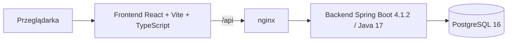

# Aplikacja do szyfrowania wiadomości

Aplikacja webowa umożliwiająca logowanie, szyfrowanie i deszyfrowanie wiadomości oraz zapis i odczyt szyfrogramów z bazy PostgreSQL. Projekt realizowany w ramach zadania rekrutacyjnego.

> **Status:** ZR-20 — usuwanie własnych wiadomości: `DELETE /api/messages/{id}` z owner scope i `204` bez ciała, cudza i nieistniejąca wiadomość dają identyczne `404`, potwierdzenie inline zamiast `window.confirm`, `404` podczas usuwania jest traktowane jako „już usunięta”, a po usunięciu ostatniej widocznej pozycji panel dociąga kolejną stronę tym samym kursorem. Backend: **128/128** (`./mvnw spotless:check verify`), frontend: **120/120** (`npm test`); curl przez nginx potwierdził `204`/`404`/`400`/`403`/`401`, a smoke Playwright usunięcie, anulowanie, `404` i brak treści w DOM — [`docs/TEST_REPORT.md`](docs/TEST_REPORT.md) i [`docs/TEST_REPORT_FRONTEND.md`](docs/TEST_REPORT_FRONTEND.md). Limiter crypto 60/30 na minutę, formalne E2E, CI i `docs/PERFORMANCE.md` pozostają do wykonania.

**Repozytorium:** <https://github.com/Aszlaczek/encryption>

## Spis treści

- [Cel projektu](#cel-projektu)
- [Zakres MVP](#zakres-mvp)
- [Poza zakresem](#poza-zakresem)
- [Model dostępu i granice bezpieczeństwa](#model-dostępu-i-granice-bezpieczeństwa)
- [Kontrakt API](#kontrakt-api)
- [Wymagania R01–R10 i planowane dowody](#wymagania-r01r10-i-planowane-dowody)
- [Architektura docelowa](#architektura-docelowa)
- [Wersje i toolchain](#wersje-i-toolchain)
- [Uruchomienie lokalne](#uruchomienie-lokalne)
- [Uruchomienie w Dockerze](#uruchomienie-w-dockerze)
- [Konta demonstracyjne](#konta-demonstracyjne)
- [Testy i weryfikacja](#testy-i-weryfikacja)
- [Ograniczenia i otwarte kwestie](#ograniczenia-i-otwarte-kwestie)
- [Decyzje architektoniczne](#decyzje-architektoniczne)
- [Struktura repozytorium](#struktura-repozytorium)

## Cel projektu

Dostarczyć kompletne, uruchamiane lokalnie w Dockerze MVP, które pokazuje:

- logowanie i utrzymanie sesji,
- szyfrowanie tekstu po stronie backendu,
- deszyfrowanie zapisanej wiadomości lub wklejonego pakietu,
- zapis i paginowany odczyt szyfrogramów,
- kontrolę dostępu opartą o właściciela wiadomości,
- walidację danych, obsługę błędów i podstawowe zabezpieczenia,
- responsywny i dostępny interfejs.

## Zakres MVP

- Logowanie sesyjne i wylogowanie.
- Dwa konta demonstracyjne zamiast publicznej rejestracji.
- Szyfrowanie AES-256-GCM bez zapisu.
- Szyfrowanie z zapisem w bazie.
- Odczyt własnych wiadomości z paginacją.
- Deszyfrowanie zapisanej wiadomości przez właściciela.
- Deszyfrowanie wklejonego pakietu przez właściciela.
- Usuwanie własnej wiadomości.
- Walidacja danych wejściowych i jednolity format błędów.
- Ochrona CSRF, limity prób i nagłówki bezpieczeństwa.
- Responsywność przy szerokościach 360, 768 i 1280 px.
- Dostępność klawiaturowa, czytelne etykiety i obsługa błędów dla czytników ekranu.
- Uruchomienie całego stosu przez Docker Compose.
- Testy jednostkowe, integracyjne, E2E i CI.

## Poza zakresem

Świadomie wyłączone z MVP:

- szyfrowanie end-to-end (E2EE),
- udostępnianie wiadomości między kontami,
- publiczna rejestracja, reset hasła i weryfikacja e-mail,
- role, konto administratora i panel administracyjny,
- załączniki, obrazy i inne pliki,
- rotacja kluczy szyfrujących,
- wiele instancji aplikacji, Redis i klastrowanie sesji,
- kopie zapasowe i odtwarzanie danych,
- OAuth, 2FA i logowanie społecznościowe,
- aplikacja mobilna,
- wielojęzyczny interfejs (UI jest polskie).

## Model dostępu i granice bezpieczeństwa

### Zasady wprost

- Każda wiadomość ma **dokładnie jednego właściciela** (`owner_id`).
- Nie istnieje mechanizm udostępniania wiadomości innemu kontu.
- Nie istnieje konto administracyjne ani rola z szerszym dostępem.
- Nie istnieje publiczna rejestracja; dostępne są wyłącznie konta demonstracyjne.
- Wiadomości są szyfrowane po stronie serwera. Backend posiada klucz i przetwarza tekst jawny — **nie jest to E2EE**.
- Wszystkie operacje na wiadomości są filtrowane po właścicielu. Próba odczytu, deszyfrowania lub usunięcia cudzego zasobu kończy się odpowiedzią `404`, bez ujawniania, czy zasób istnieje.
- Wklejony pakiet jest powiązany z właścicielem przez dodatkowe dane uwierzytelniające (AAD). Inne konto nie odszyfruje pakietu nawet po jego przechwyceniu.
- Treść wiadomości jest przechowywana wyłącznie jako szyfrogram. W tabeli `messages` nie ma kolumny `title`, `content` ani `plaintext`; lista wiadomości używa daty i identyfikatora.
- Tekst jawny nie jest zapisywany w `localStorage`, logach ani w treści błędów.
- Odpowiedzi deszyfrowania są oznaczone `Cache-Control: no-store`.
- Baza danych nie jest wystawiona na zewnątrz sieci Docker Compose.

### Endpointy publiczne

Wyłącznie poniższe ścieżki są dostępne bez aktywnej sesji:

- `GET /api/auth/csrf` — pobranie tokenu CSRF,
- `POST /api/auth/login` — logowanie,
- `GET /actuator/health` — healthcheck infrastruktury.

Pozostałe ścieżki `/api/**` wymagają uwierzytelnienia. Logowanie jest publiczne w sensie braku sesji, ale nadal wymaga poprawnego tokenu CSRF. Z actuatora publicznie udostępniany jest wyłącznie `health`.

### Sesja i CSRF

- Sesja serwerowa oparta o `JSESSIONID`, cookie `HttpOnly` i `SameSite=Lax`; wygasa po 30 minutach bezczynności.
- Sesje są przechowywane w pamięci jednej instancji; restart backendu wymaga ponownego logowania.
- Jeden użytkownik może mieć wiele równoległych sesji; wylogowanie unieważnia tylko bieżącą.
- Po zalogowaniu rotowany jest identyfikator sesji oraz token CSRF.
- Operacje zmieniające stan wymagają nagłówka `X-XSRF-TOKEN` o wartości równej cookie `XSRF-TOKEN`.
- Logowanie zawsze wymaga CSRF, nawet bez sesji. Dla chronionych zasobów `401` ma pierwszeństwo przed `403`.
- Brak lub niezgodny token → `403 CSRF_INVALID`; wylogowanie czyści oba cookie (`Max-Age=0`).
- W środowisku lokalnym cookie nie ma flagi `Secure` (HTTP); w produkcji wymagany jest TLS i `SESSION_COOKIE_SECURE=true`.
- Błędne hasło, nieistniejący login i konto wyłączone dają identyczną odpowiedź `401 INVALID_CREDENTIALS`; limit prób działa na parze IP + znormalizowany login i nie ujawnia istnienia konta.

### Szyfrowanie

- Algorytm: AES-256-GCM.
- Losowy nonce (12 bajtów) dla każdej operacji szyfrowania.
- Tag uwierzytelniający: 128 bitów (16 bajtów).
- Format pakietu: `v1.<key_id>.<base64url(nonce)>.<base64url(ciphertext)>.<base64url(tag)>`.
- AAD: `v1:<ownerId>:<keyId>` — wiąże pakiet z właścicielem i kluczem.
- Klucz: 32 bajty z pliku sekretu `APP_CRYPTO_KEY_FILE` (preferowane, montowane tylko do backendu) lub z `APP_CRYPTO_KEY` (lokalnie); walidowany przy starcie razem z `keyId=k1`.
- `key_id` (np. `k1`) i `format_version=1` są zapisywane w bazie i w kopercie.
- Brak rotacji kluczy w MVP; `key_id` rezerwuje miejsce na przyszłe wersjonowanie.

### Limity i ochrona przed nadużyciami

- Logowanie: 5 nieudanych prób na minutę na parę IP + znormalizowany login.
- Deszyfrowanie: 30 operacji na minutę na użytkownika (oba endpointy łącznie).
- Szyfrowanie: 60 operacji na minutę na użytkownika (oba endpointy łącznie).
- Maksymalna długość wiadomości: 10 000 punktów kodowych (maks. 40 000 bajtów UTF-8).
- Maksymalny ciphertext: 40 000 bajtów; nonce: 12 bajtów; tag: 16 bajtów.
- Maksymalny rozmiar pakietu: 56 000 znaków.
- Maksymalny rozmiar żądania: 65 536 B (64 KiB).
- Przekroczenie limitu zwraca `429` z nagłówkiem `Retry-After`.

## Kontrakt API

Kanoniczny kontrakt HTTP, DTO, błędów, paginacji i formatu pakietu znajduje się w [`docs/API.md`](docs/API.md). Ten dokument rozstrzyga wszystkie rozbieżności.

| Metoda | Ścieżka | Sukces | Opis |
|---|---|---|---|
| `GET` | `/api/auth/csrf` | `200` | token CSRF |
| `POST` | `/api/auth/login` | `200` | logowanie |
| `POST` | `/api/auth/logout` | `204` | wylogowanie |
| `GET` | `/api/auth/me` | `200` | bieżący użytkownik |
| `POST` | `/api/crypto/encrypt` | `200` | szyfrowanie bez zapisu |
| `POST` | `/api/crypto/decrypt` | `200` | deszyfrowanie wklejonego pakietu |
| `POST` | `/api/messages` | `201` | szyfrowanie z zapisem |
| `GET` | `/api/messages` | `200` | lista z paginacją kursorową |
| `GET` | `/api/messages/{id}` | `200` | szczegóły i pakiet |
| `POST` | `/api/messages/{id}/decrypt` | `200` | deszyfrowanie zapisanej |
| `DELETE` | `/api/messages/{id}` | `204` | usunięcie |
| `GET` | `/actuator/health` | `200`/`503` | healthcheck |

Najważniejsze reguły:

- JSON UTF-8; błędy w formacie `application/problem+json` z RFC 9457 i stabilnym polem `code`.
- Wszystkie odpowiedzi `/api/**` mają `Cache-Control: no-store`; każda ma `X-Request-Id`.
- Właściciel pochodzi wyłącznie z sesji. Żaden DTO żądania nie ma pola właściciela, a nieznane pola JSON są odrzucane.
- Cudza i nieistniejąca wiadomość po `id` dają identyczne `404`. Cudzy pakiet wklejony bez `id` daje `422`.
- Paginacja jest kursorowa: `limit` 1–50 (domyślnie 10), `nextCursor` i `hasMore`; brak `total`.
- Pakiet: `v1.<key_id>.<base64url(nonce)>.<base64url(ciphertext)>.<base64url(tag)>`; AAD `v1:<ownerId>:<keyId>`.
- Limity: 10 000 punktów kodowych / 40 000 B UTF-8 plaintextu, 56 000 znaków pakietu, 65 536 B żądania.

Walidacja dokumentacji:

```bash
node scripts/validate-api-contract.mjs
```

## Wymagania R01–R10 i planowane dowody

| ID | Wymaganie | Planowany dowód |
|---|---|---|
| R01 | Frontend JavaScript z React/Angular | React 19 + Vite 7 + TypeScript 6; `npm run build` oraz **120 testów** komponentów i klienta (Vitest 5 + RTL 16 + user-event 14); realny smoke Playwright: logowanie, reload, wylogowanie, stan `401`, szyfrowanie/deszyfrowanie, kopiowanie, zapis, lista z paginacją, izolacja użytkowników i usuwanie z potwierdzeniem; formalne E2E w kolejnym zadaniu |
| R02 | Logowanie i walidacja danych | Kontrakt logowania, sesji i CSRF w `docs/API.md`; `PasswordEncoder` Argon2id (16 MiB, 2 iteracje, salt 16 B, hash 32 B); `AppUserDetailsService` i `AppUserPrincipal`; konta demo tylko w profilu `local`; endpointy `csrf`, `login`, `me`, `logout`; rotacja sesji i CSRF; limit 5 nieudanych prób/60 s z testem wygaśnięcia okna na kontrolowanym zegarze; walidacja JSON, `413`, `415` i błędy RFC 9457; 16 testów integracyjnych auth + 7 jednostkowych; izolacja sesji A/B w `MessageIsolationIntegrationTests` (11); frontend logowania: klient API, CSRF, `/me`, mapowanie `400`/`401`/`429`, 71 testów frontendu i smoke przeglądarkowy |
| R03 | Backend Java/Spring; szyfrowanie i deszyfrowanie | Spring Boot 4.1.2 / Java 17; `./mvnw verify` z Testcontainers PostgreSQL 16 i Flyway; kontrakt AES-256-GCM w `docs/API.md`; konfiguracja klucza AES-256 (`CryptoKey`, walidacja 32 B i `keyId=k1`) oraz testy startowe; `CryptoService`/`PackageCodec` z AES-256-GCM, nonce 12 B, tagiem 128 bitów, AAD `v1:<ownerId>:<keyId>`, walidacją pakietu i wektorem z dokumentacji; 49 testów jednostkowych kryptografii (round-trip Unicode/emoji/nowych linii, nonce, tag, granice); frontend: formularze szyfrowania/deszyfrowania i round-trip pakietu na tym samym koncie (smoke Playwright) |
| R04 | Zapis i odczyt zaszyfrowanych wiadomości | Migracje `V1`–`V3` (V3 tylko komentarz), ograniczenia CHECK, FK i indeks; encje `AppUser`/`Message` i repozytoria owner-scoped z zapytaniem kursorowym; 7 testów integracyjnych na Testcontainers PostgreSQL 16 (`./mvnw verify`); walidacja schematu (`./scripts/validate-schema.sh`); kontrakt CRUD i paginacji w `docs/API.md`; `MessageIsolationIntegrationTests` (11) sprawdza faktyczne wiersze, koperty i historię Flyway; frontend `features/messages` odczytuje listę, pakiet i odszyfrowaną treść wyłącznie dla bieżącego konta (smoke: 0 identyfikatorów Boba w widoku Alicji, obcy zasób `404`) |
| R05 | Uruchomienie lokalne w Dockerze | Trzy usługi Compose z healthcheckami; jednorazowa generacja klucza (`./scripts/generate-crypto-key.sh`) → `docker compose up -d --build` kończy się `healthy`; sekret jest montowany tylko do backendu; tylko `3000:80` jest publiczne; backend łączy się z `db:5432`; wolumen `encryption_pgdata` przeżywa restart |
| R06 | Walidacja, błędy, SQL injection, XSS, kontrola dostępu | Macierz statusów, katalog kodów, `404` dla obcych zasobów i limity w `docs/API.md`; `SecurityFilterChain` z kolejnością `401` przed `403`; CSRF wymagany dla logowania i mutacji zalogowanych; odrzucanie nieznanych pól JSON; limit rozmiaru żądania; `Cache-Control: no-store` i `X-Request-Id`; walidacja klucza przy starcie i brak sekretu w Git/obrazie; testy integracyjne błędów, walidacji, `413`/`415`, `429` i izolacji sesji; testy kryptografii potwierdzają odrzucenie zmienionego AAD (obcy właściciel), tagu i klucza bez ujawnienia plaintextu; `MessageIsolationIntegrationTests` (11) potwierdza brak plaintextu A w sesji B, `404` dla obcych zasobów, CSRF oraz odrzucenie payloadów SQL injection/XSS — raport w [`docs/TEST_REPORT.md`](docs/TEST_REPORT.md) |
| R07 | Responsywność | Strona główna responsywna od 320 px; zrzuty ekranu Playwright przy 360, 768 i 1280 px w kolejnym zadaniu |
| R08 | Dostępność | Semantyczne nagłówki, landmarki, skip link i widoczny focus; formularz logowania ma `<label>`, hinty, `aria-describedby` łączące hint i błąd, `aria-invalid`, `aria-busy`, fokus na błędzie i komunikaty `role="alert"`; formularze crypto mają etykiety, liczniki w `aria-describedby`, `aria-busy`, `role="status"`/`role="alert"`, fokus na błędzie i sekcje wyników z nagłówkami; smoke przeglądarkowy potwierdza powiązania i fokus; skan axe w kolejnym zadaniu |
| R09 | Wydajność | Paginacja kursorem w API i w UI (`limit=10`, „Pobierz więcej”, kursor przekazywany bez reinterpretacji), indeks `(owner_id, created_at desc, id desc)`, limity; lista pobiera wyłącznie `id`/`createdAt`, a pakiet i plaintext dopiero po kliknięciu; pomiary `hey` i `EXPLAIN ANALYZE` w `docs/PERFORMANCE.md` (do wykonania) |
| R10 | Czytelność i podział na moduły | Backend package-by-feature, frontend `features/*` + `shared/*`, ESLint/Prettier/Spotless/Enforcer, README, ADR-10; CI w kolejnym zadaniu |

## Architektura docelowa



- `frontend/` — SPA React + Vite + TypeScript, budowana do statycznych plików i serwowana przez nginx.
- `backend/` — Spring Boot 4.1.2, Java 17, Spring Web, Security, Validation, Data JPA, Flyway; migracje w `src/main/resources/db/migration`.
- `db` (usługa Compose) — PostgreSQL 16 z wolumenem i healthcheckiem.
- nginx pełni rolę reverse proxy dla `/api`, dzięki czemu frontend i backend są w tej samej origin i nie jest potrzebny CORS.

## Wersje i toolchain

Wersje są przypięte dokładnie: `package.json` bez zakresów `^`/`~`, `package-lock.json` w repozytorium, wersja parenta i pluginów Maven w `pom.xml`, dystrybucja Mavena w wrapperze, a Node w `.nvmrc` i `engines`.

| Obszar | Wersja | Przypięcie / uwagi |
|---|---|---|
| Node.js | 22.19.0 (LTS) | `.nvmrc` = `22`, `engines` = `>=22.13.0 <23` |
| npm | 11.16.0 | `package-lock.json` |
| React / React DOM | 19.3.1 | dokładna wersja |
| Vite | 7.3.7 | dokładna wersja |
| TypeScript | 6.0.3 | dokładna wersja; `tsc -b` |
| ESLint | 10.14.0 | flat config, `typescript-eslint` 8.72.1 |
| Prettier | 3.9.10 | konfiguracja w `frontend/.prettierrc.json` |
| Vitest / jsdom | 5.1.0 / 29.0.0 | dokładne wersje |
| Java (target) | 17 | `java.version` i `release 17` |
| JDK lokalny | 27.0.1 | Spring Boot 4.1.2 wspiera Javę 17–27 |
| Spring Boot | 4.1.2 | parent w `backend/pom.xml` |
| Maven | 3.10.0 | wrapper `backend/mvnw` |
| PostgreSQL | 16 | obrazy `postgres:16-alpine` w testach i Compose |
| Testcontainers | 2.0.5 | wersja z BOM Spring Boota |
| Spotless / Enforcer | 3.11.0 / 3.7.0 | formatter i walidacja środowiska |
| Obraz build backendu | `maven:3.10.0-eclipse-temurin-17` | wieloetapowy build, multi-arch |
| Obraz runtime backendu | `eclipse-temurin:17-jre` | Ubuntu, multi-arch; alpine jest tylko `amd64` |
| Obraz build frontendu | `node:22.19-alpine` | `npm ci` + `vite build`, multi-arch |
| Obraz runtime frontendu | `nginx:1.29-alpine` | statyczne `dist/`, proxy `/api`, multi-arch |

Dlaczego takie wersje:

- **Vite 7 + `@vitejs/plugin-react` 5.2** — plugin-react 6 wymaga Vite 8; wybrano stabilną parę 7.x/5.x.
- **TypeScript 6.0.3** — `typescript-eslint` 8.72 wspiera TypeScript `<6.1.0`, więc TypeScript 7 nie jest jeszcze objęty wsparciem.
- **jsdom 29** — jsdom 30 wymaga Node `^22.22.2`, a środowisko projektu to Node 22.19.0.
- **Java 17 target przy JDK 27** — Spring Boot 4.1.2 oficjalnie wspiera Javę 17–27; obrazy Dockera budują i uruchamiają aplikację na Javie 17.
- **Runtime `eclipse-temurin:17-jre` zamiast alpine** — tag `17-jre-alpine` jest publikowany tylko dla `linux/amd64`, a host deweloperski to `arm64`; wersja `17-jre` jest multi-arch.

## Uruchomienie lokalne

Frontend:

```bash
cd frontend
nvm use
npm ci
npm run dev        # http://localhost:5173
```

Backend wymaga PostgreSQL. Najprościej uruchomić samą bazę w Dockerze:

```bash
docker run --rm --name encryption-db \
  -e POSTGRES_DB=encryption \
  -e POSTGRES_USER=encryption \
  -e POSTGRES_PASSWORD=change-me \
  -p 5432:5432 postgres:16-alpine
```

Następnie w drugim terminalu:

```bash
cd backend
APP_CRYPTO_KEY_FILE="$PWD/../.secrets/crypto.key" ./mvnw spring-boot:run
```

Klucz wygeneruj raz z katalogu głównego: `./scripts/generate-crypto-key.sh`. Bez klucza backend nie wystartuje.

Build, testy i lint (bez uruchamiania serwera):

```bash
cd frontend
npm ci
npm run lint
npm run format:check
npm run test
npm run build

cd ../backend
./mvnw verify      # Spotless, JUnit 5, Testcontainers (wymaga Dockera)
```

Sekrety:

```bash
./scripts/generate-crypto-key.sh   # jednorazowo; odmawia nadpisania
./scripts/check-secrets.sh
```

## Uruchomienie w Dockerze

Wymagany jest Docker z Compose. Cały stos opisuje `docker-compose.yml`.

Pierwszy start lub przebudowa obrazów:

```bash
./scripts/generate-crypto-key.sh   # tylko raz; plik .secrets/crypto.key
docker compose up -d --build
```

Kolejne starty bez przebudowy:

```bash
docker compose up -d
```

Adresy i dostęp:

- aplikacja: `http://localhost:3000` — **jedyny port publiczny**,
- health: `http://localhost:3000/actuator/health`,
- backend (`8080/tcp`) i baza (`5432/tcp`) nie są publikowane na hoście; są osiągalne tylko z sieci Compose.

Topologia:

- `frontend` — nginx serwuje zbudowany SPA i proxuje `/api/` oraz `/actuator/health` do `backend:8080`, dzięki czemu przeglądarka używa jednego origin,
- `backend` — Spring Boot łączy się z bazą po nazwie serwisu `db:5432`,
- `db` — PostgreSQL 16 z wolumenem `encryption_pgdata`,
- sieć `edge`: frontend + backend; sieć `data` (`internal: true`): backend + db,
- healthchecki i `depends_on: service_healthy` pilnują kolejności startu.

Konfiguracja:

```bash
cp .env.example .env   # opcjonalnie; bez .env działa ścieżka domyślna
```

- `./scripts/generate-crypto-key.sh` tworzy `.secrets/crypto.key` (base64, 32 B, mode 600). Plik jest ignorowany przez Git, nie wchodzi do obrazu i jest montowany **tylko do backendu** jako `/run/secrets/crypto_key`.
- Compose nie przekazuje materiału klucza przez `environment`; ustawia wyłącznie `APP_CRYPTO_KEY_FILE=/run/secrets/crypto_key` i `APP_CRYPTO_KEY_ID=k1`.
- Brak pliku, niepoprawny base64, długość inna niż 32 B lub nieznany `keyId` blokuje start backendu. `docker compose up` bez wygenerowanego klucza również kończy się błędem.
- **Utrata klucza oznacza trwałą utratę dostępu do istniejących wiadomości.** Nie ma automatycznej rotacji ani odzyskiwania klucza w MVP. Zmiana klucza działa jak utrata — stare pakiety pozostają nieczytelne. Zrób kopię zapasową `.secrets/crypto.key` poza repozytorium.
- `POSTGRES_*` mają domyślnie `change-me`; to również wartości wyłącznie demonstracyjne.
- Bezpośredni dostęp do bazy: `docker compose exec db psql -U encryption -d encryption` (bez publikowania portu).

Przydatne komendy:

```bash
docker compose ps
docker compose config
docker compose logs -f
docker compose down
docker compose down -v   # usuwa również wolumen bazy danych
```

## Konta demonstracyjne

Konta są tworzone wyłącznie przy aktywnym profilu `local` (`application-local.properties`). Compose ustawia ten profil domyślnie; można go nadpisać przez `SPRING_PROFILES_ACTIVE`.

| Login | Hasło | Rola |
|---|---|---|
| `alice` | `AliceDemo123!` | właściciel własnych wiadomości |
| `bob` | `BobDemo1234!` | właściciel własnych wiadomości |

- Hasła są hashowane Argon2id: salt 16 B, hash 32 B, parallelism 1, memory 16 MiB, iterations 2. Są to domyślne parametry Spring Security, przypięte jawnie w kodzie, żeby aktualizacja biblioteki nie zmieniła kosztu w ciszy.
- Hash ma 97 znaków i mieści się w kolumnie `varchar(100)`.
- `AppUserDetailsService` normalizuje login (`trim` + `toLowerCase(Locale.ROOT)`) i zwraca hash do weryfikacji przez Spring Security.
- Seed jest idempotentny i nie nadpisuje istniejących kont. Restart nie zmienia hashy.
- Poza profilem `local` seeder nie powstaje; czysta baza z profilem `prod` ma 0 kont demo.
- Poświadczenia są jawne w repozytorium — nie wolno używać ich poza demonstracją.

## Testy i weryfikacja

| Warstwa | Narzędzia | Komenda |
|---|---|---|
| Backend — jednostkowe i integracyjne | JUnit 5, Testcontainers | `cd backend && ./mvnw verify` |
| Backend — mapowanie JPA i schemat | JUnit 5, Testcontainers PostgreSQL 16, Flyway | `PersistenceIntegrationTests` — 7 testów (migracje, powtarzalny start, UNIQUE, FK/cascade, długości, repozytoria, kursor) |
| Backend — hashowanie i konta demo | JUnit 5, Spring Security, Testcontainers | 10 testów: Argon2id i długość hasha, normalizacja loginu, seed w `local`, idempotencja, brak seedu poza `local`, principal z `id` |
| Backend — logowanie, sesja i CSRF | JUnit 5, MockMvc, Spring Security, Testcontainers | `AuthIntegrationTests` — 16 testów: CSRF, login, `/me`, logout, rotacja sesji i tokenu, `401` przed `403`, nierozróżnialne błędne dane, walidacja, `413`/`415`, `429`, nieznane ścieżki, `X-Request-Id` |
| Backend — wygaśnięcie okna limitera | JUnit 5, MockMvc, Testcontainers, kontrolowany `Clock` | `AuthRateLimitWindowIntegrationTests` — 1 test: 5× `401`, 6. próba `429` z `Retry-After`, przesunięcie zegara o 61 s i ponowne logowanie `200` bez rzeczywistego czekania |
| Backend — konfiguracja i walidacja klucza | JUnit 5, `ApplicationContextRunner`, `@TempDir` | `CryptoKeyTests` (10) + `CryptoKeyStartupTests` (5): poprawny klucz inline/plik, priorytet pliku, brak klucza, zły base64, 16/33 B, nieznany `keyId`, brak pliku, brak wycieku klucza w `toString`, blokada startu kontekstu |
| Backend — AES-GCM i kodek pakietu | JUnit 5, AssertJ | `PackageCodecTests` (23) + `CryptoServiceTests` (26): wektor z `docs/API.md`, kanoniczny base64url, round-trip Unicode/emoji/spacji/nowych linii, 100 unikalnych nonce dla tego samego tekstu, tag i nonce z innego szyfrogramu, granice 40 000 B, zły AAD/klucz bez zwracania plaintextu |
| Backend — HTTP crypto | JUnit 5, MockMvc, Testcontainers PostgreSQL 16 | `CryptoControllerIntegrationTests` (5): round-trip właściciela, 401 anonimowego klienta, `422 DECRYPT_FAILED` dla pakietu innego właściciela, `400 INVALID_PACKAGE_FORMAT`, limity DTO i `no-store` |
| Backend — HTTP messages | JUnit 5, MockMvc, Testcontainers PostgreSQL 16 | `MessageControllerIntegrationTests` (5): zapis bez plaintextu, owner-scoped list/details/decrypt/delete, stabilny kursor, max 50, anonimowy 401, identyczne 404 dla cudzej i brakującej wiadomości, `204` bez ciała |
| Backend — izolacja użytkowników i persystencja | JUnit 5, MockMvc, Testcontainers PostgreSQL 16 | `MessageIsolationIntegrationTests` (11): lista/szczegóły/decrypt/delete A i B, wklejony obcy pakiet, sesja i CSRF, payloady SQL injection/XSS, faktyczne wiersze bazy i historia Flyway; raport [`docs/TEST_REPORT.md`](docs/TEST_REPORT.md) |
| Backend — limiter i problem details | JUnit 5 | `LoginRateLimiterTests` (5), `AppUserPrincipalTests` (2), `ApiProblemFactoryTests` (2) |
| Backend — format i higiena | Spotless, Enforcer | `cd backend && ./mvnw spotless:check verify` |
| Schemat bazy i migracje | PostgreSQL 16, psql, Docker | `./scripts/validate-schema.sh` |
| Kontrakt API i dokumentacja | Node.js, `node:crypto` | `node scripts/validate-api-contract.mjs` |
| Frontend — klient API, logowanie, sesja i formularze crypto | Vitest 5, RTL 16, user-event 14, jsdom | `cd frontend && npm test` — 72 testy: CSRF z cookie i retry, RFC 9457, formularz logowania (etykiety, `aria-describedby`, `aria-invalid`, fokus, pending), `400`/`401`/`429`, `/me`, retry sesji, login/logout, brak zapisów do storage; limity code point/UTF-8, mapowanie błędów crypto, kopiowanie, XSS jako tekst, 401 kończący sesję |
| Frontend — lista zapisanych wiadomości | Vitest 5, RTL 16, user-event 14, jsdom | `cd frontend && npm test` — 48 testów: kontrakt `listMessages`/`getMessage`/`decryptMessage`/`deleteMessage` (GET bez CSRF, POST/DELETE bez ciała, brak `ownerId`, kursor bez reinterpretacji), mapowanie błędów i `isMissingMessage`, paginacja i deduplikacja, retry tego samego kursora, stany ładowania/pustki/błędu, podgląd pakietu i deszyfrowanie tylko po kliknięciu, usuwanie z potwierdzeniem, `404` jako już usunięte, auto-dociągnięcie strony, XSS jako tekst, 401 kończący sesję |
| Frontend — smoke w przeglądarce | Playwright 1.64.1, Chrome, Compose | logowanie `alice` → reload → wylogowanie, `401`, cookies `HttpOnly`/`SameSite=Lax`, pusty `localStorage`/`sessionStorage`/IndexedDB; lista: jedno żądanie pierwszej strony, brak prefetchu pakietu/plaintextu, izolacja A/B, błąd strony z retry tego samego kursora, podgląd pakietu, XSS jako tekst; raport [`docs/TEST_REPORT_FRONTEND.md`](docs/TEST_REPORT_FRONTEND.md) |
| Frontend — lint i format | ESLint, Prettier | `cd frontend && npm run lint && npm run format:check` |
| Sekrety | `git grep`, `.gitignore` | `./scripts/check-secrets.sh` |

Wynik ZR-20 (weryfikacja 2026-11-14; Node.js 22.19.0, npm 11.16.0, Playwright 1.64.1 + Chrome 157, Docker Compose, PostgreSQL 16.15, JDK 27.0.1):

```text
cd backend && ./mvnw spotless:check verify -> 128/128, BUILD SUCCESS
cd frontend && npm run lint                -> OK
cd frontend && npm run format:check        -> All matched files use Prettier code style!
cd frontend && npm test                    -> 15 plików, 120/120 testów, PASS
cd frontend && npm run build               -> tsc -b + vite build; JS 250.70 kB (gzip 77.08 kB), CSS 6.91 kB
docker compose up -d --build               -> 3 kontenery healthy
curl http://localhost:3000/actuator/health -> 200
POST /api/messages (alice)                 -> 201, id
DELETE /api/messages/{id} + CSRF           -> 204, puste body, Cache-Control: no-store
GET /api/messages/{id} po usunięciu        -> 404 MESSAGE_NOT_FOUND
DELETE tego samego id ponownie             -> 404 MESSAGE_NOT_FOUND
DELETE cudzego id (bob → alice)            -> 404 MESSAGE_NOT_FOUND; wiersz alice nadal 200
DELETE losowego UUID                       -> 404 MESSAGE_NOT_FOUND
DELETE not-a-uuid                          -> 400 INVALID_MESSAGE_ID
DELETE bez CSRF                            -> 403 CSRF_INVALID
DELETE anonimowo                           -> 401 UNAUTHENTICATED
psql: deleted row count / kept row count   -> 0 / 1
smoke Playwright (Chrome, :3000)           -> PASS (21/21 kroków)
./scripts/check-secrets.sh                 -> OK
node scripts/validate-api-contract.mjs     -> OK (28 przykładów JSON, 12 endpointów, wektor AES-GCM)
git diff --check                           -> OK
```

Smoke ZR-20 potwierdził: „Usuń” pokazuje potwierdzenie i nie wysyła `DELETE` przed kliknięciem „Tak, usuń”, fokus trafia na przycisk potwierdzenia, „Anuluj” zostawia pozycję bez żądania, a po potwierdzeniu `DELETE` zwraca `204`, pozycja i odszyfrowana treść znikają z DOM. Scenariusz „już usunięta” (wiersz usunięty w tle przez `fetch` z tej samej sesji) pokazuje `role="status"` „Wiadomość była już usunięta.”, usuwa pozycję i nie renderuje alertu. Po operacjach `localStorage` i `sessionStorage` są puste, a wylogowanie usuwa listę i treść z DOM. Sekwencja żądań: `POST /api/messages 201` → `GET /api/messages?limit=10 200` → `GET /api/messages/{id} 200` → `POST …/decrypt 200` → `DELETE … 204` → `POST /api/messages 201` → `DELETE … 204` (w tle) → `DELETE … 404` (UI). Szczegóły: [`docs/TEST_REPORT_FRONTEND.md`](docs/TEST_REPORT_FRONTEND.md), scenariusze negatywne: [`docs/TEST_REPORT.md`](docs/TEST_REPORT.md).

Wynik ZR-19 (weryfikacja 2026-11-13; Node.js 22.19.0, npm 11.16.0, Playwright 1.64.1 + Chrome, Docker Compose, PostgreSQL 16):

```text
cd frontend && npm run lint          -> OK
cd frontend && npm run format:check  -> All matched files use Prettier code style!
cd frontend && npm test              -> 15 plików, 106/106 testów, PASS
cd frontend && npm run build         -> tsc -b + vite build, dist/ wygenerowany
docker compose up -d --build frontend -> frontend healthy; 3 kontenery healthy
curl http://localhost:3000/actuator/health -> 200
GET /api/messages bez sesji          -> 401 UNAUTHENTICATED
GET /api/messages?limit=10 (alice)   -> 10 pozycji, tylko id + createdAt, hasMore=true
paginacja alice do wyczerpania       -> 2 strony, 14 unikalnych, 0 duplikatów, 0 ID Boba
GET /api/messages/{id} (alice)       -> pakiet v1.…, bez plaintextu
GET/DELETE? obcy zasób (bob)         -> 404 MESSAGE_NOT_FOUND
POST /api/messages/{id}/decrypt      -> 200 tylko dla właściciela, obcy 404
cursor=not-a-cursor                  -> 400 INVALID_CURSOR
limit=0                              -> 400 VALIDATION_FAILED / OUT_OF_RANGE
smoke Playwright (Chrome, :3000)     -> PASS
```

Smoke ZR-19 potwierdził: pierwsze wejście wykonuje dokładnie jedno `GET /api/messages?limit=10` i nie pobiera żadnego pakietu ani plaintextu; w widoku Alicji nie ma identyfikatorów Boba; wymuszony `500` przy kolejnej stronie zachowuje 10 wcześniejszych pozycji i pokazuje alert, a „Spróbuj ponownie” używa tego samego kursora i dociąga 14 unikalnych wiadomości; „Pokaż pakiet” wykonuje jedno `GET /api/messages/{id}` i kopiuje pakiet; `` po deszyfrowaniu pozostaje tekstem (0 elementów `img`, brak wykonania handlera) i powstaje dokładnie jedno `POST …/decrypt`; wylogowanie usuwa listę i odszyfrowaną treść, a `localStorage`, `sessionStorage` i IndexedDB pozostają puste. Szczegóły: [`docs/TEST_REPORT_FRONTEND.md`](docs/TEST_REPORT_FRONTEND.md).

Wynik ZR-18 (weryfikacja 2026-11-13; Node.js 22.19.0, npm 11.16.0, Playwright 1.64.1 + Chrome, Docker Compose):

```text
cd frontend && npm run lint          -> OK
cd frontend && npm run format:check  -> All matched files use Prettier code style!
cd frontend && npm test              -> 11 plików, 71/71 testów, PASS
cd frontend && npm run build         -> tsc -b + vite build, dist/ wygenerowany
docker compose up -d --build frontend -> frontend healthy; 3 kontenery healthy
curl http://localhost:3000/actuator/health -> 200
curl -X POST /api/crypto/encrypt bez sesji -> 401
encrypt -> decrypt na alice                -> 200, plaintext "Zażółć gęślą jaźń 🔐"
POST /api/messages (Szyfruj i zapisz)      -> 201, id + createdAt + package
zły pakiet                                 -> 400 INVALID_PACKAGE_FORMAT
pakiet obcego pochodzenia                  -> 422 DECRYPT_FAILED
smoke Playwright (Chrome, :3000)           -> PASS
```

Smoke ZR-18 potwierdził: pusty submit blokowany z fokusem, pakiet skopiowany do schowka i odszyfrowany na tym samym koncie, `Szyfruj i zapisz` tworzy wiadomość i pokazuje ID/czas/pakiet, `` po odszyfrowaniu pozostaje tekstem (0 elementów `img`, brak wykonania handlera), a `localStorage`, `sessionStorage` i IndexedDB są puste. Szczegóły: [`docs/TEST_REPORT_FRONTEND.md`](docs/TEST_REPORT_FRONTEND.md).

Wynik ZR-17 (weryfikacja 2026-11-13; Node.js 22.19.0, npm 11.16.0, Playwright 1.64.1 + Chrome, Docker Compose):

```text
cd frontend && npm run lint          -> OK
cd frontend && npm run format:check  -> All matched files use Prettier code style!
cd frontend && npm test              -> 4 pliki, 26/26 testów, PASS
cd frontend && npm run build         -> tsc -b + vite build, dist/ wygenerowany
docker compose up -d --build         -> db/backend/frontend healthy
curl http://localhost:3000/actuator/health -> 200
curl http://localhost:3000/api/messages    -> 401 bez sesji
smoke Playwright (Chrome, http://localhost:3000) -> PASS
```

Sekwencja API w smoke: `GET /api/auth/me 401` → `GET /api/auth/csrf 200` → `POST /api/auth/login 401` → `POST /api/auth/login 200` → `GET /api/auth/me 200` → `POST /api/auth/logout 204` → `GET /api/auth/me 401`. Po logowaniu i reloadzie `JSESSIONID` ma `HttpOnly` i `SameSite=Lax`, a `localStorage`, `sessionStorage` i IndexedDB są puste. Po wylogowaniu cookies są usunięte, a hasło nie występuje w storage ani w cookies. Szczegóły: [`docs/TEST_REPORT_FRONTEND.md`](docs/TEST_REPORT_FRONTEND.md).

Wynik ZR-16 (weryfikacja 2026-11-13; JDK 27.0.1, Maven 3.10.0, Docker 29.9.1, Testcontainers 2.0.5, PostgreSQL 16.15):

```text
./mvnw -Dtest=MessageIsolationIntegrationTests test -> 10/10, BUILD SUCCESS
./mvnw spotless:check verify                       -> 125/125, BUILD SUCCESS
./scripts/check-secrets.sh                         -> OK, brak sekretów w trackowanych plikach
node scripts/validate-api-contract.mjs             -> OK (28 przykładów JSON, 12 endpointów, wektor AES-GCM)
git diff --check                                   -> OK
kontrola mutacyjna (usunięty warunek owner w find) -> 8/10 testów FAIL; po przywróceniu 10/10
```

Scenariusze ZR-16:

```text
B: lista z ownerId=A / szczegóły idA / decrypt idA        -> pusta lista / 404 MESSAGE_NOT_FOUND / 404
B: wklejony pakiet A do /api/crypto/decrypt (5 payloadów) -> 422 DECRYPT_FAILED, bez plaintextu i pakietu
A: własny decrypt (zapisany i wklejony)                   -> 200, plaintext identyczny
anonim: list/get/decrypt/encrypt                          -> 401 UNAUTHENTICATED (401 przed 403)
B: decrypt/create bez CSRF lub z błędnym tokenem          -> 403 CSRF_INVALID
B: SQL injection w id/limit/cursor, pole ownerId          -> 400 INVALID_MESSAGE_ID / VALIDATION_FAILED / INVALID_CURSOR
baza: wiersze A i B                                       -> owner_id z sesji, nonce 12 B, tag 16 B, k1, AES-256-GCM
baza: kolumny i historia Flyway                           -> brak plaintext/content/body; V1–V3 success
```

Pełny raport testów negatywnych: [`docs/TEST_REPORT.md`](docs/TEST_REPORT.md). Kod produkcyjny nie zmienił się w ZR-16.

Wynik ZR-14 (weryfikacja 2026-11-08; JDK 27.0.1, Maven 3.10.0, Docker 29.9.1, Testcontainers 2.0.5, PostgreSQL 16.15):

```text
./mvnw -Dtest=MessageControllerIntegrationTests test -> 3/3, BUILD SUCCESS
./mvnw spotless:check verify                       -> 113/113, BUILD SUCCESS
./scripts/check-secrets.sh                         -> OK, brak sekretów w trackowanych plikach
node scripts/validate-api-contract.mjs             -> OK, kontrakt, format pakietu i kursor
git diff --check                                   -> OK
```

Scenariusze HTTP ZR-14:

```text
POST /api/messages Alice                         -> 201; pakiet w odpowiedzi, właściciel z sesji
baza po zapisie                                   -> ciphertext/nonce/tag/key_id; brak kolumn plaintext/content/body
GET szczegóły i POST decrypt Alice                -> 200; pakiet i plaintext zgodne
GET lista Alice z ownerId innego UUID             -> tylko rekordy Alice; parametr właściciela ignorowany
kursor, limit=2                                   -> strony bez duplikatów; stabilny created_at DESC, id DESC
limit=51 / niepoprawny cursor                     -> 400 VALIDATION_FAILED / INVALID_CURSOR
anonimowe GET/POST                                -> 401 UNAUTHENTICATED; decrypt wymaga CSRF (403 bez tokenu)
cudza i nieistniejąca wiadomość                   -> identyczne 404 MESSAGE_NOT_FOUND
uszkodzony tag w zapisanym rekordzie               -> 500 MESSAGE_UNDECRYPTABLE, bez plaintextu
```

Limit API pozostaje 1–50 zgodnie z kanonicznym `docs/API.md`; karta Notion miała niezgodną wartość 100, poprawioną podczas ZR-14.

Wynik ZR-15 (weryfikacja 2026-11-08; JDK 27.0.1, Maven 3.10.0, Docker 29.9.1, Testcontainers 2.0.5, PostgreSQL 16.15):

```text
./mvnw -Dtest=AuthIntegrationTests,CryptoControllerIntegrationTests,MessageControllerIntegrationTests test -> 24/24, BUILD SUCCESS
./mvnw spotless:check verify -> 115/115, BUILD SUCCESS
```

Walidacja DTO mapuje przekroczenie punktów kodowych na `TOO_LONG`, a przekroczenie bajtów UTF-8 na `TOO_MANY_BYTES`. Testy potwierdzają granicę 128 B hasła, granicę plaintextu 40 000 B (10 000 emoji) oraz kontrolowany błąd bez odbicia tekstu przekraczającego limit. Błędy walidacji mają `application/problem+json`, `no-store` i `X-Request-Id`.

Wynik ZR-13 (weryfikacja 2026-11-08; JDK 27.0.1, Maven 3.10.0, Docker 29.9.1, Testcontainers 2.0.5, PostgreSQL 16.15):

```text
./mvnw -Dtest=CryptoControllerIntegrationTests test -> 4/4, BUILD SUCCESS
./mvnw spotless:check verify                       -> 110/110, BUILD SUCCESS
./scripts/check-secrets.sh                         -> OK, brak sekretów w trackowanych plikach
node scripts/validate-api-contract.mjs             -> OK, 28 przykładów JSON, 12 endpointów i wektor AES-GCM
git diff --check                                   -> OK
```

Scenariusze HTTP ZR-13:

```text
alice encrypt -> decrypt pakietu z tą samą sesją       -> 200, plaintext identyczny, Cache-Control: no-store
anonimowy POST /api/crypto/encrypt                    -> 401 UNAUTHENTICATED
pakiet alice użyty w sesji bob                        -> 422 DECRYPT_FAILED, bez plaintextu
uszkodzony pakiet                                     -> 400 INVALID_PACKAGE_FORMAT, bez danych
10 001 punktów kodowych                               -> 400 VALIDATION_FAILED
10 000 emoji (40 000 B UTF-8)                         -> 200
```
| E2E i dostępność | Playwright, axe | `cd frontend && npx playwright test` (kolejne zadanie) |
| Docker — czysty start | Docker Compose, healthchecki | `docker compose down -v && docker compose up -d --build` |
| Wydajność | `hey`, `EXPLAIN ANALYZE` | opis w `docs/PERFORMANCE.md` |
| CI | GitHub Actions | workflow w `.github/workflows/ci.yml` (kolejne zadanie) |

Wynik ZR-12 (weryfikacja 2026-11-08; JDK 27.0.1, Maven 3.10.0, Docker 29.9.1, Testcontainers 2.0.5, PostgreSQL 16.15):

```text
./mvnw -Dtest=PackageCodecTests,CryptoServiceTests test -> 49/49 (23 + 26), BUILD SUCCESS
./mvnw spotless:check verify                             -> 106/106, BUILD SUCCESS
./scripts/check-secrets.sh                               -> OK, brak sekretów w trackowanych plikach
node scripts/validate-api-contract.mjs                   -> OK, wektor AES-GCM i format pakietu zgodne
git diff --check                                         -> OK
```

Nowe przypadki ZR-12:

```text
round-trip Unicode/emoji/spacji/\n/\r\n/\t/CJK/znaku łączonego -> identyczny plaintext, ciphertext = długość UTF-8
100 szyfrowań tego samego tekstu                              -> 100 unikalnych nonce i pakietów
tag z innego szyfrogramu / nonce z innego szyfrogramu         -> DECRYPT_FAILED
zmieniony tag w pakiecie (pełna ścieżka kodek + serwis)       -> DECRYPT_FAILED
10 000 emoji = 40 000 B i 10 000 punktów kodowych             -> sukces
10 001 emoji = 40 004 B                                       -> IllegalArgumentException
pakiet z paddingiem `=` / standardowym base64 `+` `/`         -> INVALID_PACKAGE_FORMAT
1-bajtowy ciphertext w kodeku                                 -> poprawny round-trip
zmiana właściciela przez AAD                                  -> DECRYPT_FAILED (bez plaintextu)
```

Wynik ZR-11 (weryfikacja 2026-11-08; JDK 27.0.1, Maven 3.10.0, Docker 29.9.1, Testcontainers 2.0.5, PostgreSQL 16.15):

```text
./mvnw -Dtest=PackageCodecTests,CryptoServiceTests test -> 40/40 (22 + 18), BUILD SUCCESS
./mvnw spotless:check verify                             -> 97/97, BUILD SUCCESS
grep HTTP/JPA w pakiecie crypto                          -> brak importów (NO_HTTP_OR_PERSISTENCE_IMPORTS)
./scripts/check-secrets.sh                               -> OK, brak sekretów w trackowanych plikach
node scripts/validate-api-contract.mjs                   -> OK, wektor AES-GCM i format pakietu zgodne
docker compose up -d --build; docker compose restart backend
                                                         -> 3 kontenery healthy, health=200, /api/messages=401
                                                            log: Crypto key loaded for keyId=k1 (32 bytes)
                                                            log: Started BackendApplication in 2.451 seconds
```

Asercje pokryte przez 40 testów ZR-11:

```text
wektor AES-GCM                                           -> decrypt = "Zażółć gęślą jaźń 🔐"
ponowne szyfrowanie z nonce AAECAwQFBgcICQoL             -> identyczny pakiet v1.k1...
64 równoległe szyfrowania                                -> 64 unikalne nonce, każdy pakiet odszyfrowany
zły tag / obcy owner / inny klucz                        -> DECRYPT_FAILED, bez plaintextu w wyjątku
wersja v2 / keyId k2 / zły base64url                     -> UNSUPPORTED_PACKAGE_VERSION / UNKNOWN_KEY_ID / INVALID_PACKAGE_FORMAT
plaintext 40 000 B                                       -> pakiet poprawny i odszyfrowany
plaintext 40 001 B                                       -> IllegalArgumentException
```

Wynik ZR-10 (2026-11-07, JDK 27.0.1, Maven 3.10.0, Docker 29.9.1, Testcontainers 2.0.5, PostgreSQL 16):

```text
./scripts/generate-crypto-key.sh -> .secrets/crypto.key, 32 B po dekodowaniu, mode 600
drugie uruchomienie              -> exit 1; odmowa nadpisania
./mvnw spotless:check verify     -> Tests run: 57, Failures: 0, Errors: 0, Skipped: 0; BUILD SUCCESS
docker compose config            -> sekret crypto_key tylko w backendzie; brak APP_CRYPTO_KEY w environment
docker compose up -d --build     -> 3 kontenery healthy
log startu                       -> Crypto key loaded for keyId=k1 (32 bytes)
restart backendu                 -> sha256 sekretu bez zmian; ponowny start healthy
docker compose down + up -d      -> sha256 sekretu bez zmian; 3 kontenery healthy
brak pliku / brak źródła         -> exit 1; "Brak klucza AES..." / "Nie można odczytać pliku klucza AES..."
16 B                             -> exit 1; "Klucz AES musi mieć 32 bajty..."
keyId=k2                         -> exit 1; "Nieznany keyId: k2; obsługiwany: k1"
db i frontend                    -> brak /run/secrets/crypto_key
obraz backendu bez Compose       -> brak /run/secrets/crypto_key
```

Wynik ZR-09 (2026-11-06, JDK 27.0.1, Maven 3.10.0, Docker 29.9.1, Testcontainers 2.0.5, PostgreSQL 16):

```text
./mvnw spotless:check verify  -> Tests run: 42, Failures: 0, Errors: 0, Skipped: 0; BUILD SUCCESS
AuthRateLimitWindowIntegrationTests -> 1/1
  5 nieudanych logowań          -> 401 INVALID_CREDENTIALS
  6. próba                      -> 429 RATE_LIMITED; Retry-After: 60
  zegar +61 s                   -> poprawne logowanie 200; username=alice
  czas rzeczywisty testu        -> bez sleep i bez oczekiwania 60 s (MutableClock)
curl przez nginx :3000          -> 5x 401 INVALID_CREDENTIALS; 6. próba 429 RATE_LIMITED + Retry-After: 60
po 61 s przez nginx             -> 200; {"id":"...","username":"alice"}
```

Wynik ZR-08 (2026-11-06, JDK 27.0.1, Maven 3.10.0, Docker 29.9.1, Testcontainers 2.0.5, PostgreSQL 16, curl przez nginx `:3000`):

```text
./mvnw spotless:check verify  -> Tests run: 41, Failures: 0, Errors: 0, Skipped: 0; BUILD SUCCESS
GET /api/auth/csrf            -> 200; XSRF-TOKEN Path=/; SameSite=Lax; bez HttpOnly; brak sesji
POST /api/auth/login          -> 200; nowy JSESSIONID HttpOnly; SameSite=Lax; nowy XSRF-TOKEN; login znormalizowany
GET /api/auth/me              -> 200; {"id":"...","username":"alice"}
POST /api/auth/logout         -> bez tokenu 403 CSRF_INVALID; bez sesji 401 UNAUTHENTICATED; z tokenem 204
Po wylogowaniu                -> /api/auth/me 401; oba cookie wyczyszczone (Max-Age=0)
Rotacja                       -> identyfikator sesji i token CSRF zmienione; stary token z nowym cookie -> 403
Limit prób                    -> 5x 401; 6. próba 429 RATE_LIMITED z Retry-After: 60; inny login na tym samym IP -> 200
Błędne dane                   -> złe hasło i nieistniejący login: identyczny 401 poza traceId
Walidacja                     -> nieznane pole 400 VALIDATION_FAILED; zły JSON 400 MALFORMED_JSON
Transport                     -> text/plain 415; >65 536 B 413; anonimowe /api/unknown 401
Compose                       -> 3 kontenery healthy; publiczne tylko 3000:80
```

Wynik ZR-07 (2026-11-05, JDK 27.0.1, Maven 3.10.0, Docker 29.9.1, Testcontainers 2.0.5, PostgreSQL 16):

```text
Argon2id                    -> $argon2id$v=19$m=16384,t=2,p=1$; hash 97 znaków, mieści się w varchar(100)
Poprawne hasło              -> matches=true; błędne -> false (testy jednostkowe i integracyjne)
Profil prod, czysta baza    -> 0 kont demo
Profil local, czysta baza   -> alice i bob; hashe 97 znaków; is_plaintext=false
Restart backendu            -> nadal 2 konta; hashe bez zmian; log: already exists; not overwriting
Baza                        -> brak kolumny password/plaintext; brak jawnych wartości haseł
Flyway                      -> V1, V2, V3; komentarz kolumny: Argon2id password hash
./mvnw verify               -> Tests run: 17, Failures: 0, Errors: 0, Skipped: 0; BUILD SUCCESS
Compose                     -> 3 kontenery healthy; /actuator/health 200; /api/messages 401
```

Wynik ZR-06 (2026-11-05, JDK 27.0.1, Maven 3.10.0, Docker 29.9.1, Testcontainers 2.0.5, PostgreSQL 16):

```text
Pusta baza (stan ZR-06) -> Flyway zastosował V1 i V2; tabele app_users, messages, flyway_schema_history
Powtórny start (stan ZR-06) -> flyway.migrate() = 0 migracji; pending = 0; applied = 2; fingerprint schematu bez zmian
ddl-auto              -> validate; Hibernate wystartował bez błędów walidacji mapowania
UNIQUE username       -> duplikat odrzucony, SQLState 23505
FK owner_id           -> brak użytkownika odrzucony, SQLState 23503; on delete cascade usuwa wiadomości
Nonce                 -> 11 B i 13 B odrzucone (23514), 12 B przyjęte; tag 15/17 B i ciphertext 0/40001 B odrzucone
Repozytoria           -> createdAt z bazy zgodny z encją; odczyt i delete ograniczone do właściciela
Kursor                -> pierwsza strona, nextCursor z ostatniego elementu, druga strona bez duplikatów
./mvnw verify         -> Tests run: 7, Failures: 0, Errors: 0, Skipped: 0; BUILD SUCCESS
Spotless              -> check passed
```

Wynik ZR-05 (2026-11-05, Docker 29.9.1, Compose v5.6.0, macOS arm64):

```text
docker compose config                       -> OK
docker compose down -v --remove-orphans     -> usunięte
docker compose up -d --build                -> 3 obrazy zbudowane, 3 kontenery healthy
docker compose port db 5432                 -> :0 (brak publikacji)
docker compose port backend 8080            -> :0 (brak publikacji)
curl localhost:3000/                        -> HTTP 200, <html lang="pl">
curl localhost:3000/actuator/health         -> HTTP 200 {"status":"UP"}
curl localhost:3000/api/messages            -> HTTP 401 (Spring Security; log nginx: 401)
docker compose exec backend printenv DB_URL -> jdbc:postgresql://db:5432/encryption
getent hosts db                             -> 172.21.0.2 db
psql \dt                                    -> app_users, messages, flyway_schema_history
restart bez -v                              -> wiersz testowy i 2 migracje nadal w bazie
drugi docker compose up -d                  -> OK
413 przez nginx                             -> application/problem+json, PAYLOAD_TOO_LARGE
klucz z .env (stan ZR-05)                  -> nadpisany; po usunięciu .env wrócił demo; od ZR-10 wymagany plik sekretu
```

`/api/messages` zwraca `401` bez sesji — to odpowiedź Spring Security, a nie nginx, co potwierdza log accessu (`401` po proxowaniu).

Wynik ZR-04 (2026-11-04, Node.js 22.19.0, npm 11.16.0, JDK 27.0.1, Maven 3.10.0, Docker 29.9.1):

```text
Frontend  npm run lint          -> OK
Frontend  npm run format:check  -> All matched files use Prettier code style!
Frontend  npm run test          -> Test Files 1 passed (1), Tests 3 passed (3)
Frontend  npm run build         -> dist/ wygenerowany
Backend   ./mvnw verify         -> Tests run: 1, Failures: 0, Errors: 0, Skipped: 0
                                   Flyway: Successfully applied 2 migrations (v1, v2)
                                   Spotless: check passed; BUILD SUCCESS
Backend   java -jar ...         -> Started BackendApplication; /actuator/health -> HTTP 200
Frontend  vite dev              -> HTTP 200, <html lang="pl">, link do repozytorium w dist/
Sekrety   ./scripts/check-secrets.sh -> OK: brak sekretów w trackowanych plikach
```

Wynik ZR-03 (2026-11-04, Node.js v22.19.0):

```text
OK: 28 przykładów JSON, 12 endpointów, 19 kodów głównych, 8 kodów pól, 5 pakietów, 1 przykład paginacji, wektor AES-256-GCM zgodny.
```

Testy negatywne obejmują w szczególności (część auth zrealizowana w ZR-08, reszta wraz z endpointami `crypto` i `messages`):

- brak sesji i wygaśnięcie sesji,
- brak lub błędny token CSRF,
- błędne dane logowania i limit prób,
- odczyt, deszyfrowanie i usunięcie wiadomości innego użytkownika,
- payloady SQL injection i XSS,
- przekroczenie limitów długości i rozmiaru,
- uszkodzony lub obcy pakiet szyfrogramu.

## Ograniczenia i otwarte kwestie

- Aplikacja jest projektowana jako **jedna instancja**. Sesje i limity prób są przechowywane w pamięci; restart wymaga ponownego logowania.
- Brak automatycznej rotacji kluczy; `key_id=k1`, `format_version=1`.
- Brak kopii zapasowych i polityki retencji danych. Utrata `.secrets/crypto.key` oznacza trwałą utratę możliwości odszyfrowania istniejących wiadomości; nie ma mechanizmu odzyskiwania.
- Lokalnie brak TLS; produkcja wymaga terminatora TLS i cookie `Secure`.
- Brak tytułu wiadomości; lista identyfikuje wpisy datą i UUID. Dzięki temu w bazie nie ma tekstu jawnego użytkownika.
- Domyślny klucz szyfrujący nie istnieje: Compose wymaga wygenerowanego `.secrets/crypto.key`. Zmiana lub utrata klucza po zapisaniu wiadomości uniemożliwi ich odszyfrowanie.
- Domyślne hasło bazy (`change-me`) jest jawnie demonstracyjne; poza demo należy ustawić własne `POSTGRES_PASSWORD`.
- Profil `local` jest domyślny w Compose, bo stos służy do demonstracji. Wdrożenie produkcyjne musi ustawić `SPRING_PROFILES_ACTIVE` na inny profil, żeby nie utworzyć kont demo.
- Argon2id zużywa 16 MiB pamięci na weryfikację hasła; przy wielu równoległych logowaniach rośnie zapotrzebowanie na RAM.
- Hasła demo są jawne w `application-local.properties` i README; są przeznaczone wyłącznie do środowiska lokalnego.
- Backend i baza nie mają portów na hoście; debugowanie odbywa się przez `docker compose exec` lub sieć Compose.
- Obrazy budują się z `-DskipTests`, ponieważ Testcontainers wymagają Dockera hosta; testy backendu uruchamia się osobno (`./mvnw verify`).
- Encje JPA i repozytoria są warstwą wewnętrzną; API zwraca wyłącznie DTO i nie wolno zwracać encji bezpośrednio z kontrolerów.
- Vite dev server proxuje `/api` i `/actuator` na `http://localhost:8080`; cel można nadpisać przez `VITE_API_PROXY_TARGET` (np. `http://localhost:3000`). W Compose pełny przepływ zapewnia nginx w jednym origin.
- Kontrakt API jest zweryfikowany statycznie; endpointy auth, crypto i messages są pokryte testami integracyjnymi, a frontend logowania i listy wiadomości realnym smoke'em przez nginx.
- Frontend obsługuje logowanie, sesję, CSRF i wylogowanie; lista zapisanych wiadomości z paginacją, podglądem na żądanie i usuwaniem z potwierdzeniem istnieje.
- `SecurityFilterChain`, logowanie, sesja, CSRF i limiter prób są zaimplementowane. `CryptoService` i `PackageCodec` obsługują AES-256-GCM oraz walidację pakietu. `DELETE /api/messages/{id}` działa z owner scope; brakuje limitów HTTP dla szyfrowania i deszyfrowania.
- Rate limiter logowania jest lokalny dla instancji i trzyma wpisy w pamięci; nie współdzieli stanu między replikami i nie jest trwały po restarcie.
- Skrypt `check-secrets.sh` jest heurystyczny i nie zastępuje skanera historii Git.
- OpenAPI/springdoc jest odłożone; kanonicznym dokumentem pozostaje `docs/API.md`.
- Pełna lista otwartych kwestii i przyjętych wartości znajduje się w [`docs/OPEN_QUESTIONS.md`](docs/OPEN_QUESTIONS.md).

## Decyzje architektoniczne

- [`ADR-01`](docs/DECISIONS.md#adr-01--jeden-właściciel-wiadomości-brak-udostępniania-brak-e2ee) — jeden właściciel, brak udostępniania, brak E2EE.
- [`ADR-07`](docs/DECISIONS.md#adr-07--konta-demonstracyjne-zamiast-publicznej-rejestracji) — konta demonstracyjne zamiast publicznej rejestracji.
- [`ADR-08`](docs/DECISIONS.md#adr-08--model-danych-i-migracje) — UUID, relacja 1:N, brak `user_messages`.
- [`ADR-09`](docs/DECISIONS.md#adr-09--kontrakt-api-dto-i-format-pakietu) — kontrakt API, DTO i format pakietu.
- [`ADR-10`](docs/DECISIONS.md#adr-10--wersje-toolchain-i-higiena-sekretów) — wersje, toolchain i higiena sekretów.
- [`ADR-11`](docs/DECISIONS.md#adr-11--topologia-docker-compose) — topologia Compose, sieci i porty.
- [`ADR-12`](docs/DECISIONS.md#adr-12--mapowanie-jpa-i-repozytoria) — mapowanie JPA, `created_at` z bazy, repozytoria owner-scoped.
- [`ADR-13`](docs/DECISIONS.md#adr-13--argon2id-i-konta-demo-w-profilu-local) — Argon2id, parametry, seed tylko w profilu `local`.
- [`ADR-14`](docs/DECISIONS.md#adr-14--logowanie-sesja-i-csrf) — logowanie sesyjne, rotacja sesji i CSRF, kolejność `401`/`403`, limiter logowania i polityka cookie.
- [`ADR-15`](docs/DECISIONS.md#adr-15--zarządzanie-kluczem-szyfrującym) — jednorazowa generacja, sekret tylko backendu, walidacja 32 B i `keyId=k1`, utrata klucza i brak rotacji.
- [`ADR-16`](docs/DECISIONS.md#adr-16--cryptoservice-i-kodek-pakietu) — bezstanowy `CryptoService`, świeży `Cipher` na operację, AAD `v1:<ownerId>:<keyId>`, walidacja pakietu w `PackageCodec`, błędy domenowe bez HTTP.

Pełne uzasadnienia, konsekwencje i odrzucone alternatywy: [`docs/DECISIONS.md`](docs/DECISIONS.md). Szczegóły schematu: [`docs/DATA_MODEL.md`](docs/DATA_MODEL.md). Kontrakt HTTP: [`docs/API.md`](docs/API.md).

## Struktura repozytorium

```text
.
├── README.md
├── .env.example              # wyłącznie placeholdery, bez sekretów
├── docs/
│   ├── API.md
│   ├── DATA_MODEL.md
│   ├── DECISIONS.md
│   ├── OPEN_QUESTIONS.md
│   ├── PROJECT_MEMORY.md
│   ├── TEST_REPORT.md
│   └── TEST_REPORT_FRONTEND.md
├── backend/
│   ├── Dockerfile            # wieloetapowy build Maven -> JRE 17
│   ├── .dockerignore
│   ├── pom.xml               # Spring Boot 4.1.2, Java 17, zależności i pluginy
│   ├── eclipse-formatter.xml # konfiguracja Spotless
│   ├── mvnw / mvnw.cmd
│   └── src/
│       ├── main/java/com/szlaczek/backend/
│       │   ├── BackendApplication.java
│       │   ├── auth/         # AppUser, principal, logowanie, sesja, logout, limiter, seed demo
│       │   ├── auth/api/     # DTO i kontroler /api/auth
│       │   ├── crypto/       # AES-256-GCM, format pakietu
│       │   ├── message/      # Message, MessageRepository; paginacja kursorowa
│       │   └── common/
│       │       ├── security/ # SecurityFilterChain, CSRF, entry point, Argon2id
│       │       └── web/      # RFC 9457, walidacja transportu, nagłówki, limit 64 KiB
│       ├── main/resources/
│       │   ├── application.properties
│       │   ├── application-local.properties
│       │   └── db/migration/{V1__create_app_users.sql, V2__create_messages.sql, V3__update_password_hash_comment.sql}
│       └── test/java/com/szlaczek/backend/
│           ├── PersistenceIntegrationTests.java
│           ├── auth/         # logowanie, sesja, CSRF, limiter, seed i brak seedu poza local
│           └── common/       # Argon2id, problem details
├── frontend/
│   ├── Dockerfile            # Node build -> nginx
│   ├── nginx.conf            # SPA, proxy /api, problem+json 413
│   ├── .dockerignore
│   ├── package.json / package-lock.json
│   ├── eslint.config.js / .prettierrc.json
│   ├── src/
│   │   ├── app/              # App.tsx, main.tsx, testy
│   │   ├── features/
│   │   │   ├── auth/         # logowanie, sesja, CSRF, panel użytkownika
│   │   │   ├── crypto/       # formularze szyfrowania/deszyfrowania, limity, API
│   │   │   └── messages/     # lista z paginacją, podgląd pakietu i deszyfrowanie na żądanie
│   │   ├── shared/           # api/, ui/ (FormField, CopyButton)
│   │   ├── styles/
│   │   └── test/
│   └── README.md
├── scripts/
│   ├── check-secrets.sh
│   ├── validate-api-contract.mjs
│   ├── validate-schema.sh
│   └── validate-schema.sql
├── docker-compose.yml        # frontend, backend, db, sieci, wolumen
└── .github/workflows/ci.yml  # planowany (CI)
```
