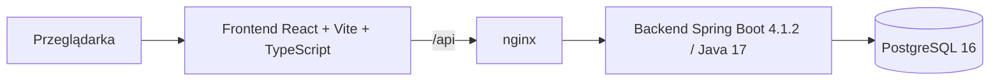

# Aplikacja do szyfrowania wiadomości

Aplikacja webowa umożliwiająca logowanie, szyfrowanie i deszyfrowanie wiadomości oraz zapis i odczyt szyfrogramów z bazy PostgreSQL. Projekt realizowany w ramach zadania rekrutacyjnego.

> **Status:** ZR-04 — repozytorium oraz szkielety frontendu (React + Vite + TypeScript) i backendu (Spring Boot 4.1.2) budują się lokalnie. Toolchain, lint, formatter i higiena sekretów działają. Endpointy nie są jeszcze zaimplementowane; Docker Compose i testy E2E należą do kolejnych zadań.

**Repozytorium:** <https://github.com/Aszlaczek/encryption>

## Spis treści

- [Cel projektu](#cel-projektu)
- [Zakres MVP](#zakres-mvp)
- [Poza zakresem](#poza-zakresem)
- [Model dostępu i granice bezpieczeństwa](#model-dostępu-i-granice-bezpieczeństwa)
- [Kontrakt API](#kontrakt-api)
- [Wymagania R01–R10 i planowane dowody](#wymagania-r01r10-i-planowane-dowody)
- [Architektura docelowa](#architektura-docelowa)
- [Wersje i toolchain](#wersje-i-toolchain)
- [Uruchomienie lokalne](#uruchomienie-lokalne)
- [Uruchomienie w Dockerze](#uruchomienie-w-dockerze)
- [Konta demonstracyjne](#konta-demonstracyjne)
- [Testy i weryfikacja](#testy-i-weryfikacja)
- [Ograniczenia i otwarte kwestie](#ograniczenia-i-otwarte-kwestie)
- [Decyzje architektoniczne](#decyzje-architektoniczne)
- [Struktura repozytorium](#struktura-repozytorium)

## Cel projektu

Dostarczyć kompletne, uruchamiane lokalnie w Dockerze MVP, które pokazuje:

- logowanie i utrzymanie sesji,
- szyfrowanie tekstu po stronie backendu,
- deszyfrowanie zapisanej wiadomości lub wklejonego pakietu,
- zapis i paginowany odczyt szyfrogramów,
- kontrolę dostępu opartą o właściciela wiadomości,
- walidację danych, obsługę błędów i podstawowe zabezpieczenia,
- responsywny i dostępny interfejs.

## Zakres MVP

- Logowanie sesyjne i wylogowanie.
- Dwa konta demonstracyjne zamiast publicznej rejestracji.
- Szyfrowanie AES-256-GCM bez zapisu.
- Szyfrowanie z zapisem w bazie.
- Odczyt własnych wiadomości z paginacją.
- Deszyfrowanie zapisanej wiadomości przez właściciela.
- Deszyfrowanie wklejonego pakietu przez właściciela.
- Usuwanie własnej wiadomości.
- Walidacja danych wejściowych i jednolity format błędów.
- Ochrona CSRF, limity prób i nagłówki bezpieczeństwa.
- Responsywność przy szerokościach 360, 768 i 1280 px.
- Dostępność klawiaturowa, czytelne etykiety i obsługa błędów dla czytników ekranu.
- Uruchomienie całego stosu przez Docker Compose.
- Testy jednostkowe, integracyjne, E2E i CI.

## Poza zakresem

Świadomie wyłączone z MVP:

- szyfrowanie end-to-end (E2EE),
- udostępnianie wiadomości między kontami,
- publiczna rejestracja, reset hasła i weryfikacja e-mail,
- role, konto administratora i panel administracyjny,
- załączniki, obrazy i inne pliki,
- rotacja kluczy szyfrujących,
- wiele instancji aplikacji, Redis i klastrowanie sesji,
- kopie zapasowe i odtwarzanie danych,
- OAuth, 2FA i logowanie społecznościowe,
- aplikacja mobilna,
- wielojęzyczny interfejs (UI jest polskie).

## Model dostępu i granice bezpieczeństwa

### Zasady wprost

- Każda wiadomość ma **dokładnie jednego właściciela** (`owner_id`).
- Nie istnieje mechanizm udostępniania wiadomości innemu kontu.
- Nie istnieje konto administracyjne ani rola z szerszym dostępem.
- Nie istnieje publiczna rejestracja; dostępne są wyłącznie konta demonstracyjne.
- Wiadomości są szyfrowane po stronie serwera. Backend posiada klucz i przetwarza tekst jawny — **nie jest to E2EE**.
- Wszystkie operacje na wiadomości są filtrowane po właścicielu. Próba odczytu, deszyfrowania lub usunięcia cudzego zasobu kończy się odpowiedzią `404`, bez ujawniania, czy zasób istnieje.
- Wklejony pakiet jest powiązany z właścicielem przez dodatkowe dane uwierzytelniające (AAD). Inne konto nie odszyfruje pakietu nawet po jego przechwyceniu.
- Treść wiadomości jest przechowywana wyłącznie jako szyfrogram. W tabeli `messages` nie ma kolumny `title`, `content` ani `plaintext`; lista wiadomości używa daty i identyfikatora.
- Tekst jawny nie jest zapisywany w `localStorage`, logach ani w treści błędów.
- Odpowiedzi deszyfrowania są oznaczone `Cache-Control: no-store`.
- Baza danych nie jest wystawiona na zewnątrz sieci Docker Compose.

### Endpointy publiczne

Wyłącznie poniższe ścieżki są dostępne bez aktywnej sesji:

- `GET /api/auth/csrf` — pobranie tokenu CSRF,
- `POST /api/auth/login` — logowanie,
- `GET /actuator/health` — healthcheck infrastruktury.

Pozostałe ścieżki `/api/**` wymagają uwierzytelnienia. Logowanie jest publiczne w sensie braku sesji, ale nadal wymaga poprawnego tokenu CSRF. Z actuatora publicznie udostępniany jest wyłącznie `health`.

### Sesja i CSRF

- Sesja oparta o `JSESSIONID`, cookie `HttpOnly` i `SameSite=Lax`.
- Operacje zmieniające stan wymagają nagłówka `X-XSRF-TOKEN`.
- Po zalogowaniu token CSRF jest odświeżany.
- Wylogowanie unieważnia sesję po stronie serwera.
- W środowisku lokalnym cookie nie ma flagi `Secure` (HTTP); w produkcji wymagany jest TLS i flaga `Secure`.

### Szyfrowanie

- Algorytm: AES-256-GCM.
- Losowy nonce (12 bajtów) dla każdej operacji szyfrowania.
- Tag uwierzytelniający: 128 bitów (16 bajtów).
- Format pakietu: `v1.<key_id>.<base64url(nonce)>.<base64url(ciphertext)>.<base64url(tag)>`.
- AAD: `v1:<ownerId>:<keyId>` — wiąże pakiet z właścicielem i kluczem.
- Klucz: 32 bajty z `APP_CRYPTO_KEY` w formacie base64; walidowany przy starcie aplikacji.
- `key_id` (np. `k1`) i `format_version=1` są zapisywane w bazie i w kopercie.
- Brak rotacji kluczy w MVP; `key_id` rezerwuje miejsce na przyszłe wersjonowanie.

### Limity i ochrona przed nadużyciami

- Logowanie: 5 nieudanych prób na minutę na parę IP + znormalizowany login.
- Deszyfrowanie: 30 operacji na minutę na użytkownika (oba endpointy łącznie).
- Szyfrowanie: 60 operacji na minutę na użytkownika (oba endpointy łącznie).
- Maksymalna długość wiadomości: 10 000 punktów kodowych (maks. 40 000 bajtów UTF-8).
- Maksymalny ciphertext: 40 000 bajtów; nonce: 12 bajtów; tag: 16 bajtów.
- Maksymalny rozmiar pakietu: 56 000 znaków.
- Maksymalny rozmiar żądania: 65 536 B (64 KiB).
- Przekroczenie limitu zwraca `429` z nagłówkiem `Retry-After`.

## Kontrakt API

Kanoniczny kontrakt HTTP, DTO, błędów, paginacji i formatu pakietu znajduje się w [`docs/API.md`](docs/API.md). Ten dokument rozstrzyga wszystkie rozbieżności.

| Metoda | Ścieżka | Sukces | Opis |
|---|---|---|---|
| `GET` | `/api/auth/csrf` | `200` | token CSRF |
| `POST` | `/api/auth/login` | `200` | logowanie |
| `POST` | `/api/auth/logout` | `204` | wylogowanie |
| `GET` | `/api/auth/me` | `200` | bieżący użytkownik |
| `POST` | `/api/crypto/encrypt` | `200` | szyfrowanie bez zapisu |
| `POST` | `/api/crypto/decrypt` | `200` | deszyfrowanie wklejonego pakietu |
| `POST` | `/api/messages` | `201` | szyfrowanie z zapisem |
| `GET` | `/api/messages` | `200` | lista z paginacją kursorową |
| `GET` | `/api/messages/{id}` | `200` | szczegóły i pakiet |
| `POST` | `/api/messages/{id}/decrypt` | `200` | deszyfrowanie zapisanej |
| `DELETE` | `/api/messages/{id}` | `204` | usunięcie |
| `GET` | `/actuator/health` | `200`/`503` | healthcheck |

Najważniejsze reguły:

- JSON UTF-8; błędy w formacie `application/problem+json` z RFC 9457 i stabilnym polem `code`.
- Wszystkie odpowiedzi `/api/**` mają `Cache-Control: no-store`; każda ma `X-Request-Id`.
- Właściciel pochodzi wyłącznie z sesji. Żaden DTO żądania nie ma pola właściciela, a nieznane pola JSON są odrzucane.
- Cudza i nieistniejąca wiadomość po `id` dają identyczne `404`. Cudzy pakiet wklejony bez `id` daje `422`.
- Paginacja jest kursorowa: `limit` 1–50 (domyślnie 10), `nextCursor` i `hasMore`; brak `total`.
- Pakiet: `v1.<key_id>.<base64url(nonce)>.<base64url(ciphertext)>.<base64url(tag)>`; AAD `v1:<ownerId>:<keyId>`.
- Limity: 10 000 punktów kodowych / 40 000 B UTF-8 plaintextu, 56 000 znaków pakietu, 65 536 B żądania.

Walidacja dokumentacji:

```bash
node scripts/validate-api-contract.mjs
```

## Wymagania R01–R10 i planowane dowody

| ID | Wymaganie | Planowany dowód |
|---|---|---|
| R01 | Frontend JavaScript z React/Angular | Szkielet React 19 + Vite 7 + TypeScript 6; `npm run build` oraz 3 testy komponentów (Vitest + RTL); E2E Playwright w kolejnym zadaniu |
| R02 | Logowanie i walidacja danych | Kontrakt logowania, sesji i CSRF w `docs/API.md`; walidacja przykładów i kodów błędów (`node scripts/validate-api-contract.mjs`); testy integracyjne i E2E w kolejnych zadaniach |
| R03 | Backend Java/Spring; szyfrowanie i deszyfrowanie | Spring Boot 4.1.2 / Java 17; `./mvnw verify` z Testcontainers PostgreSQL 16 i Flyway; kontrakt AES-256-GCM w `docs/API.md`; implementacja `CryptoService` w kolejnym zadaniu |
| R04 | Zapis i odczyt zaszyfrowanych wiadomości | Migracje `V1`/`V2`, ograniczenia CHECK, FK i indeks; walidacja na PostgreSQL 16 (`./scripts/validate-schema.sh`); test kontekstu na Testcontainers; kontrakt CRUD i paginacji w `docs/API.md` |
| R05 | Uruchomienie lokalne w Dockerze | Czysty start `docker compose down -v` → `docker compose up -d --build`; healthchecki; instrukcja w README (zadanie Docker Compose) |
| R06 | Walidacja, błędy, SQL injection, XSS, kontrola dostępu | Macierz statusów, katalog kodów, `404` dla obcych zasobów i limity w `docs/API.md`; walidacja spójności dokumentacji; testy negatywne w kolejnych zadaniach |
| R07 | Responsywność | Strona główna responsywna od 320 px; zrzuty ekranu Playwright przy 360, 768 i 1280 px w kolejnym zadaniu |
| R08 | Dostępność | Semantyczne nagłówki, landmarki, skip link i widoczny focus; skan axe w kolejnym zadaniu |
| R09 | Wydajność | Paginacja, indeks `(owner_id, created_at desc, id desc)`, limity; pomiary `hey` i `EXPLAIN ANALYZE` w `docs/PERFORMANCE.md` |
| R10 | Czytelność i podział na moduły | Backend package-by-feature, frontend `features/*` + `shared/*`, ESLint/Prettier/Spotless/Enforcer, README, ADR-10; CI w kolejnym zadaniu |

## Architektura docelowa



- `frontend/` — SPA React + Vite + TypeScript, budowana do statycznych plików i serwowana przez nginx.
- `backend/` — Spring Boot 4.1.2, Java 17, Spring Web, Security, Validation, Data JPA, Flyway; migracje w `src/main/resources/db/migration`.
- `db` (usługa Compose) — PostgreSQL 16 z wolumenem i healthcheckiem.
- nginx pełni rolę reverse proxy dla `/api`, dzięki czemu frontend i backend są w tej samej origin i nie jest potrzebny CORS.

## Wersje i toolchain

Wersje są przypięte dokładnie: `package.json` bez zakresów `^`/`~`, `package-lock.json` w repozytorium, wersja parenta i pluginów Maven w `pom.xml`, dystrybucja Mavena w wrapperze, a Node w `.nvmrc` i `engines`.

| Obszar | Wersja | Przypięcie / uwagi |
|---|---|---|
| Node.js | 22.19.0 (LTS) | `.nvmrc` = `22`, `engines` = `>=22.13.0 <23` |
| npm | 11.16.0 | `package-lock.json` |
| React / React DOM | 19.3.1 | dokładna wersja |
| Vite | 7.3.7 | dokładna wersja |
| TypeScript | 6.0.3 | dokładna wersja; `tsc -b` |
| ESLint | 10.14.0 | flat config, `typescript-eslint` 8.72.1 |
| Prettier | 3.9.10 | konfiguracja w `frontend/.prettierrc.json` |
| Vitest / jsdom | 5.1.0 / 29.0.0 | dokładne wersje |
| Java (target) | 17 | `java.version` i `release 17` |
| JDK lokalny | 27.0.1 | Spring Boot 4.1.2 wspiera Javę 17–27 |
| Spring Boot | 4.1.2 | parent w `backend/pom.xml` |
| Maven | 3.10.0 | wrapper `backend/mvnw` |
| PostgreSQL | 16 | obraz `postgres:16-alpine` w testach |
| Testcontainers | 2.0.5 | wersja z BOM Spring Boota |
| Spotless / Enforcer | 3.11.0 / 3.7.0 | formatter i walidacja środowiska |

Dlaczego takie wersje:

- **Vite 7 + `@vitejs/plugin-react` 5.2** — plugin-react 6 wymaga Vite 8; wybrano stabilną parę 7.x/5.x.
- **TypeScript 6.0.3** — `typescript-eslint` 8.72 wspiera TypeScript `<6.1.0`, więc TypeScript 7 nie jest jeszcze objęty wsparciem.
- **jsdom 29** — jsdom 30 wymaga Node `^22.22.2`, a środowisko projektu to Node 22.19.0.
- **Java 17 target przy JDK 27** — Spring Boot 4.1.2 oficjalnie wspiera Javę 17–27; obraz Docker z JDK 17 powstanie w zadaniu R05.

## Uruchomienie lokalne

Frontend:

```bash
cd frontend
nvm use
npm ci
npm run dev        # http://localhost:5173
```

Backend wymaga PostgreSQL. Najprościej uruchomić samą bazę w Dockerze:

```bash
docker run --rm --name encryption-db \
  -e POSTGRES_DB=encryption \
  -e POSTGRES_USER=encryption \
  -e POSTGRES_PASSWORD=change-me \
  -p 5432:5432 postgres:16-alpine
```

Następnie w drugim terminalu:

```bash
cd backend
./mvnw spring-boot:run
```

Build, testy i lint (bez uruchamiania serwera):

```bash
cd frontend
npm ci
npm run lint
npm run format:check
npm run test
npm run build

cd ../backend
./mvnw verify      # Spotless, JUnit 5, Testcontainers (wymaga Dockera)
```

Sekrety:

```bash
./scripts/check-secrets.sh
```

## Uruchomienie w Dockerze

> Komendy docelowe. Zostaną zweryfikowane w zadaniu dotyczącym R05; do tego czasu implementacja nie jest ukończona.

Pierwszy start lub przebudowa obrazów:

```bash
docker compose up -d --build
```

Kolejne starty bez przebudowy:

```bash
docker compose up -d
```

Przydatne komendy:

```bash
docker compose logs -f
docker compose down
docker compose down -v   # usuwa również wolumen bazy danych
```

Planowane adresy:

- frontend: `http://localhost:3000`,
- backend: `http://localhost:8080`,
- healthcheck backendu: `http://localhost:8080/actuator/health`.

Konfiguracja przez `.env` (na podstawie `.env.example`). Wartości domyślne w Compose pozwolą uruchomić projekt bez dodatkowej konfiguracji, ale klucz szyfrujący i hasła domyślne są przeznaczone **wyłącznie do środowiska demo**.

## Konta demonstracyjne

Konta są tworzone tylko przy `APP_DEMO_USERS=true` (profil lokalny/demo):

| Login | Hasło | Rola |
|---|---|---|
| `alice` | `AliceDemo123!` | właściciel własnych wiadomości |
| `bob` | `BobDemo1234!` | właściciel własnych wiadomości |

- Hasła są hashowane BCrypt.
- Seed jest idempotentny i nie nadpisuje istniejących kont.
- W środowisku produkcyjnym flagę należy ustawić na `false`.
- Poświadczenia są jawne w repozytorium — nie wolno używać ich poza demonstracją.

## Testy i weryfikacja

| Warstwa | Narzędzia | Komenda |
|---|---|---|
| Backend — jednostkowe i integracyjne | JUnit 5, Testcontainers | `cd backend && ./mvnw verify` |
| Backend — format i higiena | Spotless, Enforcer | `cd backend && ./mvnw spotless:check verify` |
| Schemat bazy i migracje | PostgreSQL 16, psql, Docker | `./scripts/validate-schema.sh` |
| Kontrakt API i dokumentacja | Node.js, `node:crypto` | `node scripts/validate-api-contract.mjs` |
| Frontend — jednostkowe i komponentowe | Vitest, React Testing Library | `cd frontend && npm run test` |
| Frontend — lint i format | ESLint, Prettier | `cd frontend && npm run lint && npm run format:check` |
| Sekrety | `git grep`, `.gitignore` | `./scripts/check-secrets.sh` |
| E2E i dostępność | Playwright, axe | `cd frontend && npx playwright test` (kolejne zadanie) |
| Docker — czysty start | Docker Compose, healthchecki | `docker compose down -v && docker compose up -d --build` (zadanie R05) |
| Wydajność | `hey`, `EXPLAIN ANALYZE` | opis w `docs/PERFORMANCE.md` |
| CI | GitHub Actions | workflow w `.github/workflows/ci.yml` (kolejne zadanie) |

Wynik ZR-04 (2026-11-04, Node.js 22.19.0, npm 11.16.0, JDK 27.0.1, Maven 3.10.0, Docker 29.9.1):

```text
Frontend  npm run lint          -> OK
Frontend  npm run format:check  -> All matched files use Prettier code style!
Frontend  npm run test          -> Test Files 1 passed (1), Tests 3 passed (3)
Frontend  npm run build         -> dist/ wygenerowany
Backend   ./mvnw verify         -> Tests run: 1, Failures: 0, Errors: 0, Skipped: 0
                                   Flyway: Successfully applied 2 migrations (v1, v2)
                                   Spotless: check passed; BUILD SUCCESS
Backend   java -jar ...         -> Started BackendApplication; /actuator/health -> HTTP 200
Frontend  vite dev              -> HTTP 200, <html lang="pl">, link do repozytorium w dist/
Sekrety   ./scripts/check-secrets.sh -> OK: brak sekretów w trackowanych plikach
```

Wynik ZR-03 (2026-11-04, Node.js v22.19.0):

```text
OK: 28 przykładów JSON, 12 endpointów, 19 kodów głównych, 8 kodów pól, 5 pakietów, 1 przykład paginacji, wektor AES-256-GCM zgodny.
```

Testy negatywne obejmą w szczególności:

- brak sesji i wygaśnięcie sesji,
- brak lub błędny token CSRF,
- błędne dane logowania i limit prób,
- odczyt, deszyfrowanie i usunięcie wiadomości innego użytkownika,
- payloady SQL injection i XSS,
- przekroczenie limitów długości i rozmiaru,
- uszkodzony lub obcy pakiet szyfrogramu.

## Ograniczenia i otwarte kwestie

- Aplikacja jest projektowana jako **jedna instancja**. Sesje i limity prób są przechowywane w pamięci; restart wymaga ponownego logowania.
- Brak rotacji kluczy; `key_id=k1`, `format_version=1`.
- Brak kopii zapasowych i polityki retencji danych.
- Lokalnie brak TLS; produkcja wymaga terminatora TLS i cookie `Secure`.
- Brak tytułu wiadomości; lista identyfikuje wpisy datą i UUID. Dzięki temu w bazie nie ma tekstu jawnego użytkownika.
- Domyślny klucz szyfrujący w Compose służy tylko do demo.
- Kontrakt API jest zweryfikowany statycznie; endpointy nie są jeszcze zaimplementowane, więc `curl` i testy kontraktowe wykonamy w kolejnych zadaniach.
- Frontend jest szkieletem strony głównej; formularze logowania i szyfrowania powstaną w kolejnych zadaniach.
- Backend nie ma jeszcze konfiguracji Spring Security zgodnej z `docs/API.md`; domyślne zabezpieczenia Springa blokują endpointy do czasu implementacji.
- Docker Compose całego stosu jeszcze nie istnieje; dostępny jest pojedynczy kontener PostgreSQL do testów i pracy lokalnej.
- Skrypt `check-secrets.sh` jest heurystyczny i nie zastępuje skanera historii Git.
- OpenAPI/springdoc jest odłożone; kanonicznym dokumentem pozostaje `docs/API.md`.
- Pełna lista otwartych kwestii i przyjętych wartości znajduje się w [`docs/OPEN_QUESTIONS.md`](docs/OPEN_QUESTIONS.md).

## Decyzje architektoniczne

- [`ADR-01`](docs/DECISIONS.md#adr-01--jeden-właściciel-wiadomości-brak-udostępniania-brak-e2ee) — jeden właściciel, brak udostępniania, brak E2EE.
- [`ADR-07`](docs/DECISIONS.md#adr-07--konta-demonstracyjne-zamiast-publicznej-rejestracji) — konta demonstracyjne zamiast publicznej rejestracji.
- [`ADR-08`](docs/DECISIONS.md#adr-08--model-danych-i-migracje) — UUID, relacja 1:N, brak `user_messages`.
- [`ADR-09`](docs/DECISIONS.md#adr-09--kontrakt-api-dto-i-format-pakietu) — kontrakt API, DTO i format pakietu.
- [`ADR-10`](docs/DECISIONS.md#adr-10--wersje-toolchain-i-higiena-sekretów) — wersje, toolchain i higiena sekretów.

Pełne uzasadnienia, konsekwencje i odrzucone alternatywy: [`docs/DECISIONS.md`](docs/DECISIONS.md). Szczegóły schematu: [`docs/DATA_MODEL.md`](docs/DATA_MODEL.md). Kontrakt HTTP: [`docs/API.md`](docs/API.md).

## Struktura repozytorium

```text
.
├── README.md
├── .env.example              # wyłącznie placeholdery, bez sekretów
├── docs/
│   ├── API.md
│   ├── DATA_MODEL.md
│   ├── DECISIONS.md
│   └── OPEN_QUESTIONS.md
├── backend/
│   ├── pom.xml               # Spring Boot 4.1.2, Java 17, zależności i pluginy
│   ├── eclipse-formatter.xml # konfiguracja Spotless
│   ├── mvnw / mvnw.cmd
│   └── src/
│       ├── main/java/com/szlaczek/backend/
│       │   ├── BackendApplication.java
│       │   ├── auth/         # logowanie, sesja, CSRF
│       │   ├── crypto/       # AES-256-GCM, format pakietu
│       │   ├── message/      # wiadomości i paginacja
│       │   └── common/
│       │       ├── security/ # konfiguracja bezpieczeństwa
│       │       └── web/      # błędy RFC 9457, nagłówki
│       ├── main/resources/
│       │   ├── application.properties
│       │   └── db/migration/{V1__create_app_users.sql, V2__create_messages.sql}
│       └── test/java/com/szlaczek/backend/BackendApplicationTests.java
├── frontend/
│   ├── package.json / package-lock.json
│   ├── eslint.config.js / .prettierrc.json
│   ├── src/
│   │   ├── app/              # App.tsx, main.tsx, testy
│   │   ├── features/         # auth/, crypto/, messages/
│   │   ├── shared/           # api/, ui/
│   │   ├── styles/
│   │   └── test/
│   └── README.md
├── scripts/
│   ├── check-secrets.sh
│   ├── validate-api-contract.mjs
│   ├── validate-schema.sh
│   └── validate-schema.sql
├── docker-compose.yml        # planowany (R05)
└── .github/workflows/ci.yml  # planowany (CI)
```
