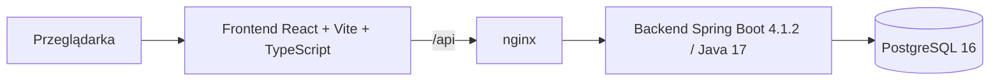

# Aplikacja do szyfrowania wiadomości

Aplikacja webowa umożliwiająca logowanie, szyfrowanie i deszyfrowanie wiadomości oraz zapis i odczyt szyfrogramów z bazy PostgreSQL. Projekt realizowany w ramach zadania rekrutacyjnego.

> **Status:** ZR-01 — potwierdzony zakres MVP i granice bezpieczeństwa. Implementacja nie została jeszcze rozpoczęta; dowody wykonania będą uzupełniane wraz z kolejnymi zadaniami.

## Spis treści

- [Cel projektu](#cel-projektu)
- [Zakres MVP](#zakres-mvp)
- [Poza zakresem](#poza-zakresem)
- [Model dostępu i granice bezpieczeństwa](#model-dostępu-i-granice-bezpieczeństwa)
- [Wymagania R01–R10 i planowane dowody](#wymagania-r01r10-i-planowane-dowody)
- [Architektura docelowa](#architektura-docelowa)
- [Uruchomienie w Dockerze](#uruchomienie-w-dockerze)
- [Konta demonstracyjne](#konta-demonstracyjne)
- [Testy i weryfikacja](#testy-i-weryfikacja)
- [Ograniczenia i otwarte kwestie](#ograniczenia-i-otwarte-kwestie)
- [Decyzje architektoniczne](#decyzje-architektoniczne)
- [Struktura repozytorium](#struktura-repozytorium)

## Cel projektu

Dostarczyć kompletne, uruchamiane lokalnie w Dockerze MVP, które pokazuje:

- logowanie i utrzymanie sesji,
- szyfrowanie tekstu po stronie backendu,
- deszyfrowanie zapisanej wiadomości lub wklejonego pakietu,
- zapis i paginowany odczyt szyfrogramów,
- kontrolę dostępu opartą o właściciela wiadomości,
- walidację danych, obsługę błędów i podstawowe zabezpieczenia,
- responsywny i dostępny interfejs.

## Zakres MVP

- Logowanie sesyjne i wylogowanie.
- Dwa konta demonstracyjne zamiast publicznej rejestracji.
- Szyfrowanie AES-256-GCM bez zapisu.
- Szyfrowanie z zapisem w bazie.
- Odczyt własnych wiadomości z paginacją.
- Deszyfrowanie zapisanej wiadomości przez właściciela.
- Deszyfrowanie wklejonego pakietu przez właściciela.
- Usuwanie własnej wiadomości.
- Walidacja danych wejściowych i jednolity format błędów.
- Ochrona CSRF, limity prób i nagłówki bezpieczeństwa.
- Responsywność przy szerokościach 360, 768 i 1280 px.
- Dostępność klawiaturowa, czytelne etykiety i obsługa błędów dla czytników ekranu.
- Uruchomienie całego stosu przez Docker Compose.
- Testy jednostkowe, integracyjne, E2E i CI.

## Poza zakresem

Świadomie wyłączone z MVP:

- szyfrowanie end-to-end (E2EE),
- udostępnianie wiadomości między kontami,
- publiczna rejestracja, reset hasła i weryfikacja e-mail,
- role, konto administratora i panel administracyjny,
- załączniki, obrazy i inne pliki,
- rotacja kluczy szyfrujących,
- wiele instancji aplikacji, Redis i klastrowanie sesji,
- kopie zapasowe i odtwarzanie danych,
- OAuth, 2FA i logowanie społecznościowe,
- aplikacja mobilna,
- wielojęzyczny interfejs (UI jest polskie).

## Model dostępu i granice bezpieczeństwa

### Zasady wprost

- Każda wiadomość ma **dokładnie jednego właściciela** (`owner_id`).
- Nie istnieje mechanizm udostępniania wiadomości innemu kontu.
- Nie istnieje konto administracyjne ani rola z szerszym dostępem.
- Nie istnieje publiczna rejestracja; dostępne są wyłącznie konta demonstracyjne.
- Wiadomości są szyfrowane po stronie serwera. Backend posiada klucz i przetwarza tekst jawny — **nie jest to E2EE**.
- Wszystkie operacje na wiadomości są filtrowane po właścicielu. Próba odczytu, deszyfrowania lub usunięcia cudzego zasobu kończy się odpowiedzią `404`, bez ujawniania, czy zasób istnieje.
- Wklejony pakiet jest powiązany z właścicielem przez dodatkowe dane uwierzytelniające (AAD). Inne konto nie odszyfruje pakietu nawet po jego przechwyceniu.
- Treść wiadomości jest przechowywana wyłącznie jako szyfrogram. Tytuł wiadomości jest przechowywany jawnie, ale widoczny tylko dla właściciela.
- Tekst jawny nie jest zapisywany w `localStorage`, logach ani w treści błędów.
- Odpowiedzi deszyfrowania są oznaczone `Cache-Control: no-store`.
- Baza danych nie jest wystawiona na zewnątrz sieci Docker Compose.

### Endpointy publiczne

Wyłącznie poniższe ścieżki są dostępne bez aktywnej sesji:

- `GET /api/auth/csrf` — pobranie tokenu CSRF,
- `POST /api/auth/login` — logowanie,
- `GET /actuator/health` — healthcheck infrastruktury.

Pozostałe ścieżki `/api/**` wymagają uwierzytelnienia. Logowanie jest publiczne w sensie braku sesji, ale nadal wymaga poprawnego tokenu CSRF. Z actuatora publicznie udostępniany jest wyłącznie `health`.

### Sesja i CSRF

- Sesja oparta o `JSESSIONID`, cookie `HttpOnly` i `SameSite=Lax`.
- Operacje zmieniające stan wymagają nagłówka `X-XSRF-TOKEN`.
- Po zalogowaniu token CSRF jest odświeżany.
- Wylogowanie unieważnia sesję po stronie serwera.
- W środowisku lokalnym cookie nie ma flagi `Secure` (HTTP); w produkcji wymagany jest TLS i flaga `Secure`.

### Szyfrowanie

- Algorytm: AES-256-GCM.
- Losowy IV (12 bajtów) dla każdej operacji szyfrowania.
- Tag uwierzytelniający: 128 bitów.
- Format pakietu: `v1.<base64url(iv)>.<base64url(ciphertext || tag)>`.
- AAD: `v1:<ownerId>` — wiąże pakiet z właścicielem.
- Klucz: 32 bajty z `APP_CRYPTO_KEY` w formacie base64; walidowany przy starcie aplikacji.
- Brak rotacji kluczy w MVP; pole `key_version` rezerwuje miejsce na przyszłe wersjonowanie.

### Limity i ochrona przed nadużyciami

- Logowanie: 5 prób na minutę na parę IP + nazwa użytkownika.
- Deszyfrowanie: 30 operacji na minutę na użytkownika.
- Szyfrowanie: 60 operacji na minutę na użytkownika.
- Maksymalna długość wiadomości: 10 000 znaków.
- Maksymalny rozmiar pakietu: 20 000 znaków.
- Maksymalny rozmiar żądania: 64 KB.
- Przekroczenie limitu zwraca `429` z nagłówkiem `Retry-After`.

## Wymagania R01–R10 i planowane dowody

| ID | Wymaganie | Planowany dowód |
|---|---|---|
| R01 | Frontend JavaScript z React/Angular | React + Vite + TypeScript (kompilowany do JavaScript); testy komponentów Vitest/RTL; E2E Playwright pełnego przepływu |
| R02 | Logowanie i walidacja danych | Testy integracyjne logowania, błędnych danych, sesji i CSRF; scenariusz E2E |
| R03 | Backend Java/Spring; szyfrowanie i deszyfrowanie | Testy jednostkowe `CryptoService` (roundtrip, tampering, zły klucz, zły właściciel) oraz testy API |
| R04 | Zapis i odczyt zaszyfrowanych wiadomości | Migracje Flyway; testy integracyjne na PostgreSQL z Testcontainers; testy repozytorium i paginacji |
| R05 | Uruchomienie lokalne w Dockerze | Czysty start `docker compose down -v` → `docker compose up -d --build`; healthchecki; instrukcja w README |
| R06 | Walidacja, błędy, SQL injection, XSS, kontrola dostępu | Testy negatywne: walidacja, CSRF `403`, dwa konta i `404`, payloady SQLi/XSS, limit `429` |
| R07 | Responsywność | Zrzuty ekranu Playwright przy 360, 768 i 1280 px |
| R08 | Dostępność | Skan axe; checklista klawiatury, fokusu, etykiet i komunikatów dla czytnika ekranu |
| R09 | Wydajność | Paginacja, indeks `(owner_id, created_at desc)`, limity; pomiary `hey` i `EXPLAIN ANALYZE` w `docs/PERFORMANCE.md` |
| R10 | Czytelność i podział na moduły | Podział backendu package-by-feature, osobne moduły `frontend`/`backend`, README, ADR, CI |

## Architektura docelowa



- `frontend/` — SPA React + Vite + TypeScript, budowana do statycznych plików i serwowana przez nginx.
- `backend/` — Spring Boot 4.1.2, Java 17, Spring Web, Security, Validation, Data JPA, Flyway.
- `db` (usługa Compose) — PostgreSQL 16 z wolumenem i healthcheckiem.
- nginx pełni rolę reverse proxy dla `/api`, dzięki czemu frontend i backend są w tej samej origin i nie jest potrzebny CORS.

## Uruchomienie w Dockerze

> Komendy docelowe. Zostaną zweryfikowane w zadaniu dotyczącym R05; do tego czasu implementacja nie jest ukończona.

Pierwszy start lub przebudowa obrazów:

```bash
docker compose up -d --build
```

Kolejne starty bez przebudowy:

```bash
docker compose up -d
```

Przydatne komendy:

```bash
docker compose logs -f
docker compose down
docker compose down -v   # usuwa również wolumen bazy danych
```

Planowane adresy:

- frontend: `http://localhost:3000`,
- backend: `http://localhost:8080`,
- healthcheck backendu: `http://localhost:8080/actuator/health`.

Konfiguracja przez `.env` (na podstawie `.env.example`). Wartości domyślne w Compose pozwolą uruchomić projekt bez dodatkowej konfiguracji, ale klucz szyfrujący i hasła domyślne są przeznaczone **wyłącznie do środowiska demo**.

## Konta demonstracyjne

Konta są tworzone tylko przy `APP_DEMO_USERS=true` (profil lokalny/demo):

| Login | Hasło | Rola |
|---|---|---|
| `alice` | `AliceDemo123!` | właściciel własnych wiadomości |
| `bob` | `BobDemo1234!` | właściciel własnych wiadomości |

- Hasła są hashowane BCrypt.
- Seed jest idempotentny i nie nadpisuje istniejących kont.
- W środowisku produkcyjnym flagę należy ustawić na `false`.
- Poświadczenia są jawne w repozytorium — nie wolno używać ich poza demonstracją.

## Testy i weryfikacja

| Warstwa | Narzędzia | Planowana komenda |
|---|---|---|
| Backend — jednostkowe i integracyjne | JUnit 5, MockMvc, Testcontainers | `cd backend && ./mvnw verify` |
| Frontend — jednostkowe i komponentowe | Vitest, React Testing Library, MSW | `cd frontend && npm run test -- --run` |
| E2E i dostępność | Playwright, axe | `cd frontend && npx playwright test` |
| Docker — czysty start | Docker Compose, healthchecki | `docker compose down -v && docker compose up -d --build` |
| Wydajność | `hey`, `EXPLAIN ANALYZE` | opis w `docs/PERFORMANCE.md` |
| CI | GitHub Actions | workflow w `.github/workflows/ci.yml` |

Testy negatywne obejmą w szczególności:

- brak sesji i wygaśnięcie sesji,
- brak lub błędny token CSRF,
- błędne dane logowania i limit prób,
- odczyt, deszyfrowanie i usunięcie wiadomości innego użytkownika,
- payloady SQL injection i XSS,
- przekroczenie limitów długości i rozmiaru,
- uszkodzony lub obcy pakiet szyfrogramu.

## Ograniczenia i otwarte kwestie

- Aplikacja jest projektowana jako **jedna instancja**. Sesje i limity prób są przechowywane w pamięci; restart wymaga ponownego logowania.
- Brak rotacji kluczy; `key_version=1`.
- Brak kopii zapasowych i polityki retencji danych.
- Lokalnie brak TLS; produkcja wymaga terminatora TLS i cookie `Secure`.
- Tytuł wiadomości jest przechowywany jawnie, ale widoczny tylko dla właściciela; szyfrowana jest treść.
- Domyślny klucz szyfrujący w Compose służy tylko do demo.
- Pełna lista otwartych kwestii i przyjętych wartości znajduje się w [`docs/OPEN_QUESTIONS.md`](docs/OPEN_QUESTIONS.md).

## Decyzje architektoniczne

- [`ADR-01`](docs/DECISIONS.md#adr-01--jeden-właściciel-wiadomości-brak-udostępniania-brak-e2ee) — jeden właściciel, brak udostępniania, brak E2EE.
- [`ADR-07`](docs/DECISIONS.md#adr-07--konta-demonstracyjne-zamiast-publicznej-rejestracji) — konta demonstracyjne zamiast publicznej rejestracji.

Pełne uzasadnienia, konsekwencje i odrzucone alternatywy: [`docs/DECISIONS.md`](docs/DECISIONS.md).

## Struktura repozytorium

```text
.
├── README.md
├── docs/
│   ├── DECISIONS.md
│   └── OPEN_QUESTIONS.md
├── backend/                 # Spring Boot (rozwijany w kolejnych zadaniach)
├── frontend/                # React + Vite (planowany)
├── docker-compose.yml       # planowany
└── .env.example             # planowany
```
