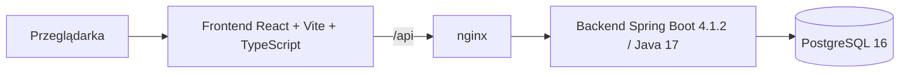

# Aplikacja do szyfrowania wiadomości

Aplikacja webowa umożliwiająca logowanie, szyfrowanie i deszyfrowanie wiadomości oraz zapis i odczyt szyfrogramów z bazy PostgreSQL. Projekt realizowany w ramach zadania rekrutacyjnego.

> **Status:** ZR-08 — logowanie, sesja serwerowa i CSRF działają zgodnie z [`docs/API.md`](docs/API.md). Dostępne są `GET /api/auth/csrf`, `POST /api/auth/login`, `GET /api/auth/me` i `POST /api/auth/logout`, z rotacją identyfikatora sesji i tokenu CSRF po logowaniu, limitem 5 nieudanych prób na 60 s na parę IP + login oraz błędami RFC 9457 z kolejnością `401` przed `403`. Testy backendu: **41/41**. Endpointy `crypto` i `messages`, frontend logowania, testy E2E i CI pozostają do wykonania.

**Repozytorium:** <https://github.com/Aszlaczek/encryption>

## Spis treści

- [Cel projektu](#cel-projektu)
- [Zakres MVP](#zakres-mvp)
- [Poza zakresem](#poza-zakresem)
- [Model dostępu i granice bezpieczeństwa](#model-dostępu-i-granice-bezpieczeństwa)
- [Kontrakt API](#kontrakt-api)
- [Wymagania R01–R10 i planowane dowody](#wymagania-r01r10-i-planowane-dowody)
- [Architektura docelowa](#architektura-docelowa)
- [Wersje i toolchain](#wersje-i-toolchain)
- [Uruchomienie lokalne](#uruchomienie-lokalne)
- [Uruchomienie w Dockerze](#uruchomienie-w-dockerze)
- [Konta demonstracyjne](#konta-demonstracyjne)
- [Testy i weryfikacja](#testy-i-weryfikacja)
- [Ograniczenia i otwarte kwestie](#ograniczenia-i-otwarte-kwestie)
- [Decyzje architektoniczne](#decyzje-architektoniczne)
- [Struktura repozytorium](#struktura-repozytorium)

## Cel projektu

Dostarczyć kompletne, uruchamiane lokalnie w Dockerze MVP, które pokazuje:

- logowanie i utrzymanie sesji,
- szyfrowanie tekstu po stronie backendu,
- deszyfrowanie zapisanej wiadomości lub wklejonego pakietu,
- zapis i paginowany odczyt szyfrogramów,
- kontrolę dostępu opartą o właściciela wiadomości,
- walidację danych, obsługę błędów i podstawowe zabezpieczenia,
- responsywny i dostępny interfejs.

## Zakres MVP

- Logowanie sesyjne i wylogowanie.
- Dwa konta demonstracyjne zamiast publicznej rejestracji.
- Szyfrowanie AES-256-GCM bez zapisu.
- Szyfrowanie z zapisem w bazie.
- Odczyt własnych wiadomości z paginacją.
- Deszyfrowanie zapisanej wiadomości przez właściciela.
- Deszyfrowanie wklejonego pakietu przez właściciela.
- Usuwanie własnej wiadomości.
- Walidacja danych wejściowych i jednolity format błędów.
- Ochrona CSRF, limity prób i nagłówki bezpieczeństwa.
- Responsywność przy szerokościach 360, 768 i 1280 px.
- Dostępność klawiaturowa, czytelne etykiety i obsługa błędów dla czytników ekranu.
- Uruchomienie całego stosu przez Docker Compose.
- Testy jednostkowe, integracyjne, E2E i CI.

## Poza zakresem

Świadomie wyłączone z MVP:

- szyfrowanie end-to-end (E2EE),
- udostępnianie wiadomości między kontami,
- publiczna rejestracja, reset hasła i weryfikacja e-mail,
- role, konto administratora i panel administracyjny,
- załączniki, obrazy i inne pliki,
- rotacja kluczy szyfrujących,
- wiele instancji aplikacji, Redis i klastrowanie sesji,
- kopie zapasowe i odtwarzanie danych,
- OAuth, 2FA i logowanie społecznościowe,
- aplikacja mobilna,
- wielojęzyczny interfejs (UI jest polskie).

## Model dostępu i granice bezpieczeństwa

### Zasady wprost

- Każda wiadomość ma **dokładnie jednego właściciela** (`owner_id`).
- Nie istnieje mechanizm udostępniania wiadomości innemu kontu.
- Nie istnieje konto administracyjne ani rola z szerszym dostępem.
- Nie istnieje publiczna rejestracja; dostępne są wyłącznie konta demonstracyjne.
- Wiadomości są szyfrowane po stronie serwera. Backend posiada klucz i przetwarza tekst jawny — **nie jest to E2EE**.
- Wszystkie operacje na wiadomości są filtrowane po właścicielu. Próba odczytu, deszyfrowania lub usunięcia cudzego zasobu kończy się odpowiedzią `404`, bez ujawniania, czy zasób istnieje.
- Wklejony pakiet jest powiązany z właścicielem przez dodatkowe dane uwierzytelniające (AAD). Inne konto nie odszyfruje pakietu nawet po jego przechwyceniu.
- Treść wiadomości jest przechowywana wyłącznie jako szyfrogram. W tabeli `messages` nie ma kolumny `title`, `content` ani `plaintext`; lista wiadomości używa daty i identyfikatora.
- Tekst jawny nie jest zapisywany w `localStorage`, logach ani w treści błędów.
- Odpowiedzi deszyfrowania są oznaczone `Cache-Control: no-store`.
- Baza danych nie jest wystawiona na zewnątrz sieci Docker Compose.

### Endpointy publiczne

Wyłącznie poniższe ścieżki są dostępne bez aktywnej sesji:

- `GET /api/auth/csrf` — pobranie tokenu CSRF,
- `POST /api/auth/login` — logowanie,
- `GET /actuator/health` — healthcheck infrastruktury.

Pozostałe ścieżki `/api/**` wymagają uwierzytelnienia. Logowanie jest publiczne w sensie braku sesji, ale nadal wymaga poprawnego tokenu CSRF. Z actuatora publicznie udostępniany jest wyłącznie `health`.

### Sesja i CSRF

- Sesja serwerowa oparta o `JSESSIONID`, cookie `HttpOnly` i `SameSite=Lax`; wygasa po 30 minutach bezczynności.
- Sesje są przechowywane w pamięci jednej instancji; restart backendu wymaga ponownego logowania.
- Jeden użytkownik może mieć wiele równoległych sesji; wylogowanie unieważnia tylko bieżącą.
- Po zalogowaniu rotowany jest identyfikator sesji oraz token CSRF.
- Operacje zmieniające stan wymagają nagłówka `X-XSRF-TOKEN` o wartości równej cookie `XSRF-TOKEN`.
- Logowanie zawsze wymaga CSRF, nawet bez sesji. Dla chronionych zasobów `401` ma pierwszeństwo przed `403`.
- Brak lub niezgodny token → `403 CSRF_INVALID`; wylogowanie czyści oba cookie (`Max-Age=0`).
- W środowisku lokalnym cookie nie ma flagi `Secure` (HTTP); w produkcji wymagany jest TLS i `SESSION_COOKIE_SECURE=true`.
- Błędne hasło, nieistniejący login i konto wyłączone dają identyczną odpowiedź `401 INVALID_CREDENTIALS`; limit prób działa na parze IP + znormalizowany login i nie ujawnia istnienia konta.

### Szyfrowanie

- Algorytm: AES-256-GCM.
- Losowy nonce (12 bajtów) dla każdej operacji szyfrowania.
- Tag uwierzytelniający: 128 bitów (16 bajtów).
- Format pakietu: `v1.<key_id>.<base64url(nonce)>.<base64url(ciphertext)>.<base64url(tag)>`.
- AAD: `v1:<ownerId>:<keyId>` — wiąże pakiet z właścicielem i kluczem.
- Klucz: 32 bajty z `APP_CRYPTO_KEY` w formacie base64; walidowany przy starcie aplikacji.
- `key_id` (np. `k1`) i `format_version=1` są zapisywane w bazie i w kopercie.
- Brak rotacji kluczy w MVP; `key_id` rezerwuje miejsce na przyszłe wersjonowanie.

### Limity i ochrona przed nadużyciami

- Logowanie: 5 nieudanych prób na minutę na parę IP + znormalizowany login.
- Deszyfrowanie: 30 operacji na minutę na użytkownika (oba endpointy łącznie).
- Szyfrowanie: 60 operacji na minutę na użytkownika (oba endpointy łącznie).
- Maksymalna długość wiadomości: 10 000 punktów kodowych (maks. 40 000 bajtów UTF-8).
- Maksymalny ciphertext: 40 000 bajtów; nonce: 12 bajtów; tag: 16 bajtów.
- Maksymalny rozmiar pakietu: 56 000 znaków.
- Maksymalny rozmiar żądania: 65 536 B (64 KiB).
- Przekroczenie limitu zwraca `429` z nagłówkiem `Retry-After`.

## Kontrakt API

Kanoniczny kontrakt HTTP, DTO, błędów, paginacji i formatu pakietu znajduje się w [`docs/API.md`](docs/API.md). Ten dokument rozstrzyga wszystkie rozbieżności.

| Metoda | Ścieżka | Sukces | Opis |
|---|---|---|---|
| `GET` | `/api/auth/csrf` | `200` | token CSRF |
| `POST` | `/api/auth/login` | `200` | logowanie |
| `POST` | `/api/auth/logout` | `204` | wylogowanie |
| `GET` | `/api/auth/me` | `200` | bieżący użytkownik |
| `POST` | `/api/crypto/encrypt` | `200` | szyfrowanie bez zapisu |
| `POST` | `/api/crypto/decrypt` | `200` | deszyfrowanie wklejonego pakietu |
| `POST` | `/api/messages` | `201` | szyfrowanie z zapisem |
| `GET` | `/api/messages` | `200` | lista z paginacją kursorową |
| `GET` | `/api/messages/{id}` | `200` | szczegóły i pakiet |
| `POST` | `/api/messages/{id}/decrypt` | `200` | deszyfrowanie zapisanej |
| `DELETE` | `/api/messages/{id}` | `204` | usunięcie |
| `GET` | `/actuator/health` | `200`/`503` | healthcheck |

Najważniejsze reguły:

- JSON UTF-8; błędy w formacie `application/problem+json` z RFC 9457 i stabilnym polem `code`.
- Wszystkie odpowiedzi `/api/**` mają `Cache-Control: no-store`; każda ma `X-Request-Id`.
- Właściciel pochodzi wyłącznie z sesji. Żaden DTO żądania nie ma pola właściciela, a nieznane pola JSON są odrzucane.
- Cudza i nieistniejąca wiadomość po `id` dają identyczne `404`. Cudzy pakiet wklejony bez `id` daje `422`.
- Paginacja jest kursorowa: `limit` 1–50 (domyślnie 10), `nextCursor` i `hasMore`; brak `total`.
- Pakiet: `v1.<key_id>.<base64url(nonce)>.<base64url(ciphertext)>.<base64url(tag)>`; AAD `v1:<ownerId>:<keyId>`.
- Limity: 10 000 punktów kodowych / 40 000 B UTF-8 plaintextu, 56 000 znaków pakietu, 65 536 B żądania.

Walidacja dokumentacji:

```bash
node scripts/validate-api-contract.mjs
```

## Wymagania R01–R10 i planowane dowody

| ID | Wymaganie | Planowany dowód |
|---|---|---|
| R01 | Frontend JavaScript z React/Angular | Szkielet React 19 + Vite 7 + TypeScript 6; `npm run build` oraz 3 testy komponentów (Vitest + RTL); E2E Playwright w kolejnym zadaniu |
| R02 | Logowanie i walidacja danych | Kontrakt logowania, sesji i CSRF w `docs/API.md`; `PasswordEncoder` Argon2id (16 MiB, 2 iteracje, salt 16 B, hash 32 B); `AppUserDetailsService` i `AppUserPrincipal`; konta demo tylko w profilu `local`; endpointy `csrf`, `login`, `me`, `logout`; rotacja sesji i CSRF; limit 5 nieudanych prób/minutę; walidacja JSON, `413`, `415` i błędy RFC 9457; 15 testów integracyjnych auth + 7 jednostkowych; E2E w kolejnym zadaniu |
| R03 | Backend Java/Spring; szyfrowanie i deszyfrowanie | Spring Boot 4.1.2 / Java 17; `./mvnw verify` z Testcontainers PostgreSQL 16 i Flyway; kontrakt AES-256-GCM w `docs/API.md`; implementacja `CryptoService` w kolejnym zadaniu |
| R04 | Zapis i odczyt zaszyfrowanych wiadomości | Migracje `V1`–`V3` (V3 tylko komentarz), ograniczenia CHECK, FK i indeks; encje `AppUser`/`Message` i repozytoria owner-scoped z zapytaniem kursorowym; 7 testów integracyjnych na Testcontainers PostgreSQL 16 (`./mvnw verify`); walidacja schematu (`./scripts/validate-schema.sh`); kontrakt CRUD i paginacji w `docs/API.md` |
| R05 | Uruchomienie lokalne w Dockerze | Trzy usługi Compose z healthcheckami; `docker compose down -v` → `docker compose up -d --build` kończy się `healthy`; tylko `3000:80` jest publiczne; backend łączy się z `db:5432`; wolumen `encryption_pgdata` przeżywa restart |
| R06 | Walidacja, błędy, SQL injection, XSS, kontrola dostępu | Macierz statusów, katalog kodów, `404` dla obcych zasobów i limity w `docs/API.md`; `SecurityFilterChain` z kolejnością `401` przed `403`; CSRF wymagany dla logowania i mutacji zalogowanych; odrzucanie nieznanych pól JSON; limit rozmiaru żądania; `Cache-Control: no-store` i `X-Request-Id`; testy integracyjne błędów, walidacji, `413`/`415`, `429` i izolacji sesji |
| R07 | Responsywność | Strona główna responsywna od 320 px; zrzuty ekranu Playwright przy 360, 768 i 1280 px w kolejnym zadaniu |
| R08 | Dostępność | Semantyczne nagłówki, landmarki, skip link i widoczny focus; skan axe w kolejnym zadaniu |
| R09 | Wydajność | Paginacja, indeks `(owner_id, created_at desc, id desc)`, limity; pomiary `hey` i `EXPLAIN ANALYZE` w `docs/PERFORMANCE.md` |
| R10 | Czytelność i podział na moduły | Backend package-by-feature, frontend `features/*` + `shared/*`, ESLint/Prettier/Spotless/Enforcer, README, ADR-10; CI w kolejnym zadaniu |

## Architektura docelowa



- `frontend/` — SPA React + Vite + TypeScript, budowana do statycznych plików i serwowana przez nginx.
- `backend/` — Spring Boot 4.1.2, Java 17, Spring Web, Security, Validation, Data JPA, Flyway; migracje w `src/main/resources/db/migration`.
- `db` (usługa Compose) — PostgreSQL 16 z wolumenem i healthcheckiem.
- nginx pełni rolę reverse proxy dla `/api`, dzięki czemu frontend i backend są w tej samej origin i nie jest potrzebny CORS.

## Wersje i toolchain

Wersje są przypięte dokładnie: `package.json` bez zakresów `^`/`~`, `package-lock.json` w repozytorium, wersja parenta i pluginów Maven w `pom.xml`, dystrybucja Mavena w wrapperze, a Node w `.nvmrc` i `engines`.

| Obszar | Wersja | Przypięcie / uwagi |
|---|---|---|
| Node.js | 22.19.0 (LTS) | `.nvmrc` = `22`, `engines` = `>=22.13.0 <23` |
| npm | 11.16.0 | `package-lock.json` |
| React / React DOM | 19.3.1 | dokładna wersja |
| Vite | 7.3.7 | dokładna wersja |
| TypeScript | 6.0.3 | dokładna wersja; `tsc -b` |
| ESLint | 10.14.0 | flat config, `typescript-eslint` 8.72.1 |
| Prettier | 3.9.10 | konfiguracja w `frontend/.prettierrc.json` |
| Vitest / jsdom | 5.1.0 / 29.0.0 | dokładne wersje |
| Java (target) | 17 | `java.version` i `release 17` |
| JDK lokalny | 27.0.1 | Spring Boot 4.1.2 wspiera Javę 17–27 |
| Spring Boot | 4.1.2 | parent w `backend/pom.xml` |
| Maven | 3.10.0 | wrapper `backend/mvnw` |
| PostgreSQL | 16 | obrazy `postgres:16-alpine` w testach i Compose |
| Testcontainers | 2.0.5 | wersja z BOM Spring Boota |
| Spotless / Enforcer | 3.11.0 / 3.7.0 | formatter i walidacja środowiska |
| Obraz build backendu | `maven:3.10.0-eclipse-temurin-17` | wieloetapowy build, multi-arch |
| Obraz runtime backendu | `eclipse-temurin:17-jre` | Ubuntu, multi-arch; alpine jest tylko `amd64` |
| Obraz build frontendu | `node:22.19-alpine` | `npm ci` + `vite build`, multi-arch |
| Obraz runtime frontendu | `nginx:1.29-alpine` | statyczne `dist/`, proxy `/api`, multi-arch |

Dlaczego takie wersje:

- **Vite 7 + `@vitejs/plugin-react` 5.2** — plugin-react 6 wymaga Vite 8; wybrano stabilną parę 7.x/5.x.
- **TypeScript 6.0.3** — `typescript-eslint` 8.72 wspiera TypeScript `<6.1.0`, więc TypeScript 7 nie jest jeszcze objęty wsparciem.
- **jsdom 29** — jsdom 30 wymaga Node `^22.22.2`, a środowisko projektu to Node 22.19.0.
- **Java 17 target przy JDK 27** — Spring Boot 4.1.2 oficjalnie wspiera Javę 17–27; obrazy Dockera budują i uruchamiają aplikację na Javie 17.
- **Runtime `eclipse-temurin:17-jre` zamiast alpine** — tag `17-jre-alpine` jest publikowany tylko dla `linux/amd64`, a host deweloperski to `arm64`; wersja `17-jre` jest multi-arch.

## Uruchomienie lokalne

Frontend:

```bash
cd frontend
nvm use
npm ci
npm run dev        # http://localhost:5173
```

Backend wymaga PostgreSQL. Najprościej uruchomić samą bazę w Dockerze:

```bash
docker run --rm --name encryption-db \
  -e POSTGRES_DB=encryption \
  -e POSTGRES_USER=encryption \
  -e POSTGRES_PASSWORD=change-me \
  -p 5432:5432 postgres:16-alpine
```

Następnie w drugim terminalu:

```bash
cd backend
./mvnw spring-boot:run
```

Build, testy i lint (bez uruchamiania serwera):

```bash
cd frontend
npm ci
npm run lint
npm run format:check
npm run test
npm run build

cd ../backend
./mvnw verify      # Spotless, JUnit 5, Testcontainers (wymaga Dockera)
```

Sekrety:

```bash
./scripts/check-secrets.sh
```

## Uruchomienie w Dockerze

Wymagany jest Docker z Compose. Cały stos opisuje `docker-compose.yml`.

Pierwszy start lub przebudowa obrazów:

```bash
docker compose up -d --build
```

Kolejne starty bez przebudowy:

```bash
docker compose up -d
```

Adresy i dostęp:

- aplikacja: `http://localhost:3000` — **jedyny port publiczny**,
- health: `http://localhost:3000/actuator/health`,
- backend (`8080/tcp`) i baza (`5432/tcp`) nie są publikowane na hoście; są osiągalne tylko z sieci Compose.

Topologia:

- `frontend` — nginx serwuje zbudowany SPA i proxuje `/api/` oraz `/actuator/health` do `backend:8080`, dzięki czemu przeglądarka używa jednego origin,
- `backend` — Spring Boot łączy się z bazą po nazwie serwisu `db:5432`,
- `db` — PostgreSQL 16 z wolumenem `encryption_pgdata`,
- sieć `edge`: frontend + backend; sieć `data` (`internal: true`): backend + db,
- healthchecki i `depends_on: service_healthy` pilnują kolejności startu.

Konfiguracja:

```bash
cp .env.example .env   # opcjonalnie; bez .env działają wartości demo
```

- `APP_CRYPTO_KEY` ustawiony w `.env` lub środowisku nadpisuje klucz demo. Bez niego Compose używa stałego **zerowego klucza demo** (wyłącznie do demonstracji).
- Zmiana klucza po zapisaniu wiadomości uniemożliwi ich odszyfrowanie; rotacja kluczy jest poza MVP.
- `POSTGRES_*` mają domyślnie `change-me`; to również wartości wyłącznie demonstracyjne.
- Bezpośredni dostęp do bazy: `docker compose exec db psql -U encryption -d encryption` (bez publikowania portu).

Przydatne komendy:

```bash
docker compose ps
docker compose config
docker compose logs -f
docker compose down
docker compose down -v   # usuwa również wolumen bazy danych
```

## Konta demonstracyjne

Konta są tworzone wyłącznie przy aktywnym profilu `local` (`application-local.properties`). Compose ustawia ten profil domyślnie; można go nadpisać przez `SPRING_PROFILES_ACTIVE`.

| Login | Hasło | Rola |
|---|---|---|
| `alice` | `AliceDemo123!` | właściciel własnych wiadomości |
| `bob` | `BobDemo1234!` | właściciel własnych wiadomości |

- Hasła są hashowane Argon2id: salt 16 B, hash 32 B, parallelism 1, memory 16 MiB, iterations 2. Są to domyślne parametry Spring Security, przypięte jawnie w kodzie, żeby aktualizacja biblioteki nie zmieniła kosztu w ciszy.
- Hash ma 97 znaków i mieści się w kolumnie `varchar(100)`.
- `AppUserDetailsService` normalizuje login (`trim` + `toLowerCase(Locale.ROOT)`) i zwraca hash do weryfikacji przez Spring Security.
- Seed jest idempotentny i nie nadpisuje istniejących kont. Restart nie zmienia hashy.
- Poza profilem `local` seeder nie powstaje; czysta baza z profilem `prod` ma 0 kont demo.
- Poświadczenia są jawne w repozytorium — nie wolno używać ich poza demonstracją.

## Testy i weryfikacja

| Warstwa | Narzędzia | Komenda |
|---|---|---|
| Backend — jednostkowe i integracyjne | JUnit 5, Testcontainers | `cd backend && ./mvnw verify` |
| Backend — mapowanie JPA i schemat | JUnit 5, Testcontainers PostgreSQL 16, Flyway | `PersistenceIntegrationTests` — 7 testów (migracje, powtarzalny start, UNIQUE, FK/cascade, długości, repozytoria, kursor) |
| Backend — hashowanie i konta demo | JUnit 5, Spring Security, Testcontainers | 10 testów: Argon2id i długość hasha, normalizacja loginu, seed w `local`, idempotencja, brak seedu poza `local`, principal z `id` |
| Backend — logowanie, sesja i CSRF | JUnit 5, MockMvc, Spring Security, Testcontainers | `AuthIntegrationTests` — 15 testów: CSRF, login, `/me`, logout, rotacja sesji i tokenu, `401` przed `403`, nierozróżnialne błędne dane, walidacja, `413`/`415`, `429`, nieznane ścieżki, `X-Request-Id` |
| Backend — limiter i problem details | JUnit 5 | `LoginRateLimiterTests` (5), `AppUserPrincipalTests` (2), `ApiProblemFactoryTests` (2) |
| Backend — format i higiena | Spotless, Enforcer | `cd backend && ./mvnw spotless:check verify` |
| Schemat bazy i migracje | PostgreSQL 16, psql, Docker | `./scripts/validate-schema.sh` |
| Kontrakt API i dokumentacja | Node.js, `node:crypto` | `node scripts/validate-api-contract.mjs` |
| Frontend — jednostkowe i komponentowe | Vitest, React Testing Library | `cd frontend && npm run test` |
| Frontend — lint i format | ESLint, Prettier | `cd frontend && npm run lint && npm run format:check` |
| Sekrety | `git grep`, `.gitignore` | `./scripts/check-secrets.sh` |
| E2E i dostępność | Playwright, axe | `cd frontend && npx playwright test` (kolejne zadanie) |
| Docker — czysty start | Docker Compose, healthchecki | `docker compose down -v && docker compose up -d --build` |
| Wydajność | `hey`, `EXPLAIN ANALYZE` | opis w `docs/PERFORMANCE.md` |
| CI | GitHub Actions | workflow w `.github/workflows/ci.yml` (kolejne zadanie) |

Wynik ZR-08 (2026-11-06, JDK 27.0.1, Maven 3.10.0, Docker 29.9.1, Testcontainers 2.0.5, PostgreSQL 16, curl przez nginx `:3000`):

```text
./mvnw spotless:check verify  -> Tests run: 41, Failures: 0, Errors: 0, Skipped: 0; BUILD SUCCESS
GET /api/auth/csrf            -> 200; XSRF-TOKEN Path=/; SameSite=Lax; bez HttpOnly; brak sesji
POST /api/auth/login          -> 200; nowy JSESSIONID HttpOnly; SameSite=Lax; nowy XSRF-TOKEN; login znormalizowany
GET /api/auth/me              -> 200; {"id":"...","username":"alice"}
POST /api/auth/logout         -> bez tokenu 403 CSRF_INVALID; bez sesji 401 UNAUTHENTICATED; z tokenem 204
Po wylogowaniu                -> /api/auth/me 401; oba cookie wyczyszczone (Max-Age=0)
Rotacja                       -> identyfikator sesji i token CSRF zmienione; stary token z nowym cookie -> 403
Limit prób                    -> 5x 401; 6. próba 429 RATE_LIMITED z Retry-After: 60; inny login na tym samym IP -> 200
Błędne dane                   -> złe hasło i nieistniejący login: identyczny 401 poza traceId
Walidacja                     -> nieznane pole 400 VALIDATION_FAILED; zły JSON 400 MALFORMED_JSON
Transport                     -> text/plain 415; >65 536 B 413; anonimowe /api/unknown 401
Compose                       -> 3 kontenery healthy; publiczne tylko 3000:80
```

Wynik ZR-07 (2026-11-05, JDK 27.0.1, Maven 3.10.0, Docker 29.9.1, Testcontainers 2.0.5, PostgreSQL 16):

```text
Argon2id                    -> $argon2id$v=19$m=16384,t=2,p=1$; hash 97 znaków, mieści się w varchar(100)
Poprawne hasło              -> matches=true; błędne -> false (testy jednostkowe i integracyjne)
Profil prod, czysta baza    -> 0 kont demo
Profil local, czysta baza   -> alice i bob; hashe 97 znaków; is_plaintext=false
Restart backendu            -> nadal 2 konta; hashe bez zmian; log: already exists; not overwriting
Baza                        -> brak kolumny password/plaintext; brak jawnych wartości haseł
Flyway                      -> V1, V2, V3; komentarz kolumny: Argon2id password hash
./mvnw verify               -> Tests run: 17, Failures: 0, Errors: 0, Skipped: 0; BUILD SUCCESS
Compose                     -> 3 kontenery healthy; /actuator/health 200; /api/messages 401
```

Wynik ZR-06 (2026-11-05, JDK 27.0.1, Maven 3.10.0, Docker 29.9.1, Testcontainers 2.0.5, PostgreSQL 16):

```text
Pusta baza (stan ZR-06) -> Flyway zastosował V1 i V2; tabele app_users, messages, flyway_schema_history
Powtórny start (stan ZR-06) -> flyway.migrate() = 0 migracji; pending = 0; applied = 2; fingerprint schematu bez zmian
ddl-auto              -> validate; Hibernate wystartował bez błędów walidacji mapowania
UNIQUE username       -> duplikat odrzucony, SQLState 23505
FK owner_id           -> brak użytkownika odrzucony, SQLState 23503; on delete cascade usuwa wiadomości
Nonce                 -> 11 B i 13 B odrzucone (23514), 12 B przyjęte; tag 15/17 B i ciphertext 0/40001 B odrzucone
Repozytoria           -> createdAt z bazy zgodny z encją; odczyt i delete ograniczone do właściciela
Kursor                -> pierwsza strona, nextCursor z ostatniego elementu, druga strona bez duplikatów
./mvnw verify         -> Tests run: 7, Failures: 0, Errors: 0, Skipped: 0; BUILD SUCCESS
Spotless              -> check passed
```

Wynik ZR-05 (2026-11-05, Docker 29.9.1, Compose v5.6.0, macOS arm64):

```text
docker compose config                       -> OK
docker compose down -v --remove-orphans     -> usunięte
docker compose up -d --build                -> 3 obrazy zbudowane, 3 kontenery healthy
docker compose port db 5432                 -> :0 (brak publikacji)
docker compose port backend 8080            -> :0 (brak publikacji)
curl localhost:3000/                        -> HTTP 200, <html lang="pl">
curl localhost:3000/actuator/health         -> HTTP 200 {"status":"UP"}
curl localhost:3000/api/messages            -> HTTP 401 (Spring Security; log nginx: 401)
docker compose exec backend printenv DB_URL -> jdbc:postgresql://db:5432/encryption
getent hosts db                             -> 172.21.0.2 db
psql \dt                                    -> app_users, messages, flyway_schema_history
restart bez -v                              -> wiersz testowy i 2 migracje nadal w bazie
drugi docker compose up -d                  -> OK
413 przez nginx                             -> application/problem+json, PAYLOAD_TOO_LARGE
klucz z .env                                -> nadpisany; po usunięciu .env wrócił demo
```

`/api/messages` zwraca `401`, bo endpointy nie są jeszcze zaimplementowane — to odpowiedź Spring Security, a nie nginx, co potwierdza log accessu (`401` po proxowaniu).

Wynik ZR-04 (2026-11-04, Node.js 22.19.0, npm 11.16.0, JDK 27.0.1, Maven 3.10.0, Docker 29.9.1):

```text
Frontend  npm run lint          -> OK
Frontend  npm run format:check  -> All matched files use Prettier code style!
Frontend  npm run test          -> Test Files 1 passed (1), Tests 3 passed (3)
Frontend  npm run build         -> dist/ wygenerowany
Backend   ./mvnw verify         -> Tests run: 1, Failures: 0, Errors: 0, Skipped: 0
                                   Flyway: Successfully applied 2 migrations (v1, v2)
                                   Spotless: check passed; BUILD SUCCESS
Backend   java -jar ...         -> Started BackendApplication; /actuator/health -> HTTP 200
Frontend  vite dev              -> HTTP 200, <html lang="pl">, link do repozytorium w dist/
Sekrety   ./scripts/check-secrets.sh -> OK: brak sekretów w trackowanych plikach
```

Wynik ZR-03 (2026-11-04, Node.js v22.19.0):

```text
OK: 28 przykładów JSON, 12 endpointów, 19 kodów głównych, 8 kodów pól, 5 pakietów, 1 przykład paginacji, wektor AES-256-GCM zgodny.
```

Testy negatywne obejmują w szczególności (część auth zrealizowana w ZR-08, reszta wraz z endpointami `crypto` i `messages`):

- brak sesji i wygaśnięcie sesji,
- brak lub błędny token CSRF,
- błędne dane logowania i limit prób,
- odczyt, deszyfrowanie i usunięcie wiadomości innego użytkownika,
- payloady SQL injection i XSS,
- przekroczenie limitów długości i rozmiaru,
- uszkodzony lub obcy pakiet szyfrogramu.

## Ograniczenia i otwarte kwestie

- Aplikacja jest projektowana jako **jedna instancja**. Sesje i limity prób są przechowywane w pamięci; restart wymaga ponownego logowania.
- Brak rotacji kluczy; `key_id=k1`, `format_version=1`.
- Brak kopii zapasowych i polityki retencji danych.
- Lokalnie brak TLS; produkcja wymaga terminatora TLS i cookie `Secure`.
- Brak tytułu wiadomości; lista identyfikuje wpisy datą i UUID. Dzięki temu w bazie nie ma tekstu jawnego użytkownika.
- Domyślny klucz szyfrujący w Compose jest zerowy i służy tylko do demo; można go nadpisać przez `APP_CRYPTO_KEY`. Zmiana klucza po zapisaniu wiadomości uniemożliwi ich odszyfrowanie.
- Domyślne hasło bazy (`change-me`) jest jawnie demonstracyjne; poza demo należy ustawić własne `POSTGRES_PASSWORD`.
- Profil `local` jest domyślny w Compose, bo stos służy do demonstracji. Wdrożenie produkcyjne musi ustawić `SPRING_PROFILES_ACTIVE` na inny profil, żeby nie utworzyć kont demo.
- Argon2id zużywa 16 MiB pamięci na weryfikację hasła; przy wielu równoległych logowaniach rośnie zapotrzebowanie na RAM.
- Hasła demo są jawne w `application-local.properties` i README; są przeznaczone wyłącznie do środowiska lokalnego.
- Backend i baza nie mają portów na hoście; debugowanie odbywa się przez `docker compose exec` lub sieć Compose.
- Obrazy budują się z `-DskipTests`, ponieważ Testcontainers wymagają Dockera hosta; testy backendu uruchamia się osobno (`./mvnw verify`).
- Encje JPA i repozytoria są warstwą wewnętrzną; nie są jeszcze używane przez API i nie wolno zwracać ich bezpośrednio z kontrolerów. DTO oraz endpointy powstaną w kolejnych zadaniach.
- Vite dev server nie proxuje jeszcze `/api`; pełny przepływ w jednym origin zapewnia Compose, a proxy dla trybu dev powstanie wraz z implementacją API.
- Kontrakt API jest zweryfikowany statycznie, a endpointy logowania, sesji i CSRF są pokryte testami integracyjnymi i sprawdzone przez `curl`. Endpointy `crypto` i `messages` pozostają do zaimplementowania.
- Frontend jest szkieletem strony głównej; formularz logowania, obsługa CSRF i formularze szyfrowania powstaną w kolejnych zadaniach.
- `SecurityFilterChain`, logowanie, sesja, CSRF i limiter prób są zaimplementowane. Brakuje `CryptoService`, DTO/endpointów wiadomości oraz limitów dla szyfrowania i deszyfrowania.
- Rate limiter logowania jest lokalny dla instancji i trzyma wpisy w pamięci; nie współdzieli stanu między replikami i nie jest trwały po restarcie.
- Skrypt `check-secrets.sh` jest heurystyczny i nie zastępuje skanera historii Git.
- OpenAPI/springdoc jest odłożone; kanonicznym dokumentem pozostaje `docs/API.md`.
- Pełna lista otwartych kwestii i przyjętych wartości znajduje się w [`docs/OPEN_QUESTIONS.md`](docs/OPEN_QUESTIONS.md).

## Decyzje architektoniczne

- [`ADR-01`](docs/DECISIONS.md#adr-01--jeden-właściciel-wiadomości-brak-udostępniania-brak-e2ee) — jeden właściciel, brak udostępniania, brak E2EE.
- [`ADR-07`](docs/DECISIONS.md#adr-07--konta-demonstracyjne-zamiast-publicznej-rejestracji) — konta demonstracyjne zamiast publicznej rejestracji.
- [`ADR-08`](docs/DECISIONS.md#adr-08--model-danych-i-migracje) — UUID, relacja 1:N, brak `user_messages`.
- [`ADR-09`](docs/DECISIONS.md#adr-09--kontrakt-api-dto-i-format-pakietu) — kontrakt API, DTO i format pakietu.
- [`ADR-10`](docs/DECISIONS.md#adr-10--wersje-toolchain-i-higiena-sekretów) — wersje, toolchain i higiena sekretów.
- [`ADR-11`](docs/DECISIONS.md#adr-11--topologia-docker-compose) — topologia Compose, sieci i porty.
- [`ADR-12`](docs/DECISIONS.md#adr-12--mapowanie-jpa-i-repozytoria) — mapowanie JPA, `created_at` z bazy, repozytoria owner-scoped.
- [`ADR-13`](docs/DECISIONS.md#adr-13--argon2id-i-konta-demo-w-profilu-local) — Argon2id, parametry, seed tylko w profilu `local`.
- [`ADR-14`](docs/DECISIONS.md#adr-14--logowanie-sesja-i-csrf) — logowanie sesyjne, rotacja sesji i CSRF, kolejność `401`/`403`, limiter logowania i polityka cookie.

Pełne uzasadnienia, konsekwencje i odrzucone alternatywy: [`docs/DECISIONS.md`](docs/DECISIONS.md). Szczegóły schematu: [`docs/DATA_MODEL.md`](docs/DATA_MODEL.md). Kontrakt HTTP: [`docs/API.md`](docs/API.md).

## Struktura repozytorium

```text
.
├── README.md
├── .env.example              # wyłącznie placeholdery, bez sekretów
├── docs/
│   ├── API.md
│   ├── DATA_MODEL.md
│   ├── DECISIONS.md
│   └── OPEN_QUESTIONS.md
├── backend/
│   ├── Dockerfile            # wieloetapowy build Maven -> JRE 17
│   ├── .dockerignore
│   ├── pom.xml               # Spring Boot 4.1.2, Java 17, zależności i pluginy
│   ├── eclipse-formatter.xml # konfiguracja Spotless
│   ├── mvnw / mvnw.cmd
│   └── src/
│       ├── main/java/com/szlaczek/backend/
│       │   ├── BackendApplication.java
│       │   ├── auth/         # AppUser, principal, logowanie, sesja, logout, limiter, seed demo
│       │   ├── auth/api/     # DTO i kontroler /api/auth
│       │   ├── crypto/       # AES-256-GCM, format pakietu
│       │   ├── message/      # Message, MessageRepository; paginacja kursorowa
│       │   └── common/
│       │       ├── security/ # SecurityFilterChain, CSRF, entry point, Argon2id
│       │       └── web/      # RFC 9457, walidacja transportu, nagłówki, limit 64 KiB
│       ├── main/resources/
│       │   ├── application.properties
│       │   ├── application-local.properties
│       │   └── db/migration/{V1__create_app_users.sql, V2__create_messages.sql, V3__update_password_hash_comment.sql}
│       └── test/java/com/szlaczek/backend/
│           ├── PersistenceIntegrationTests.java
│           ├── auth/         # logowanie, sesja, CSRF, limiter, seed i brak seedu poza local
│           └── common/       # Argon2id, problem details
├── frontend/
│   ├── Dockerfile            # Node build -> nginx
│   ├── nginx.conf            # SPA, proxy /api, problem+json 413
│   ├── .dockerignore
│   ├── package.json / package-lock.json
│   ├── eslint.config.js / .prettierrc.json
│   ├── src/
│   │   ├── app/              # App.tsx, main.tsx, testy
│   │   ├── features/         # auth/, crypto/, messages/
│   │   ├── shared/           # api/, ui/
│   │   ├── styles/
│   │   └── test/
│   └── README.md
├── scripts/
│   ├── check-secrets.sh
│   ├── validate-api-contract.mjs
│   ├── validate-schema.sh
│   └── validate-schema.sql
├── docker-compose.yml        # frontend, backend, db, sieci, wolumen
└── .github/workflows/ci.yml  # planowany (CI)
```
