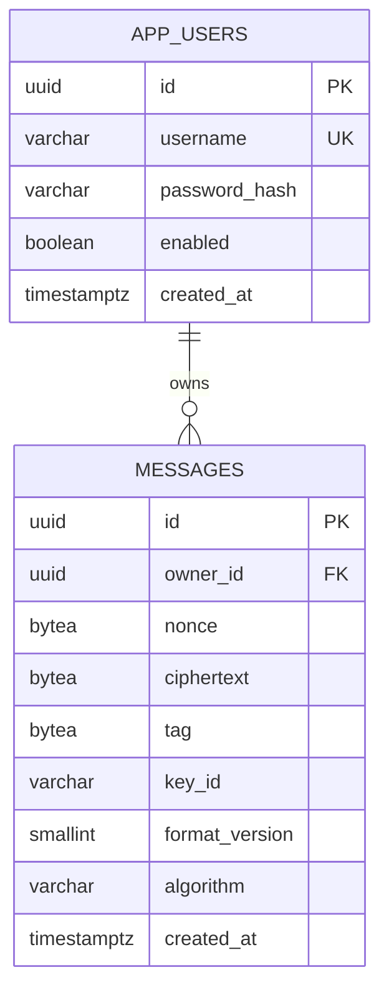

# Model danych i migracje

Dokument opisuje model danych MVP, migracje projektowe oraz uzasadnienie zmian względem pierwotnego szkicu `User/Message/UserMessage`.

- **Zadanie:** ZR-02 — model danych i migracje projektowe.
- **Data:** 2026-11-04.
- **Wymagania:** R04, R06, R09.
- **Status:** model i migracje zweryfikowane na PostgreSQL 16; podłączenie Flyway i testów Testcontainers pozostaje do zadania backendowego.

## Cele modelu

- Jeden właściciel wiadomości, relacja 1:N, bez udostępniania.
- Brak kolumn przechowujących hasło jawne lub treść jawną wiadomości.
- UUID jako identyfikatory publiczne — brak enumeracji kolejnych ID.
- Jawna wersja koperty (`format_version`) i identyfikator klucza (`key_id`).
- Ograniczenia integralności wymuszane przez bazę, nie tylko przez aplikację.
- Indeks wspierający paginację po właścicielu i czasie.

## ERD



`APP_USERS` 1 — N `MESSAGES`. Tabela `user_messages` nie istnieje.

## Tabele

### `app_users`

| Kolumna | Typ | Null | Domyślnie | Opis |
|---|---|---|---|---|
| `id` | `uuid` | nie | `gen_random_uuid()` | Klucz główny |
| `username` | `varchar(50)` | nie | — | Znormalizowany login |
| `password_hash` | `varchar(100)` | nie | — | Wyłącznie hash BCrypt |
| `enabled` | `boolean` | nie | `true` | Czy konto jest aktywne |
| `created_at` | `timestamptz` | nie | `now()` | Data utworzenia |

Ograniczenia:

- `app_users_username_unique` — unikalność loginu,
- `app_users_username_normalized` — `username = lower(btrim(username))`,
- `app_users_username_format` — `^[a-z0-9][a-z0-9._-]{2,49}$`,
- `app_users_password_hash_not_blank` — hash nie może być pusty.

### `messages`

| Kolumna | Typ | Null | Domyślnie | Opis |
|---|---|---|---|---|
| `id` | `uuid` | nie | `gen_random_uuid()` | Klucz główny |
| `owner_id` | `uuid` | nie | — | Właściciel, FK do `app_users.id` |
| `nonce` | `bytea` | nie | — | Nonce AES-GCM, dokładnie 12 B |
| `ciphertext` | `bytea` | nie | — | Szyfrogram, 1–40 000 B |
| `tag` | `bytea` | nie | — | Tag GCM, dokładnie 16 B |
| `key_id` | `varchar(32)` | nie | — | Identyfikator klucza, np. `k1` |
| `format_version` | `smallint` | nie | `1` | Wersja formatu koperty |
| `algorithm` | `varchar(32)` | nie | `AES-256-GCM` | Algorytm szyfrowania |
| `created_at` | `timestamptz` | nie | `now()` | Data utworzenia |

Ograniczenia:

- `messages_owner_fk` — `owner_id` → `app_users.id` `on delete cascade`,
- `messages_nonce_length` — `octet_length(nonce) = 12`,
- `messages_ciphertext_length` — `octet_length(ciphertext) between 1 and 40000`,
- `messages_tag_length` — `octet_length(tag) = 16`,
- `messages_key_id_format` — `^[a-z0-9][a-z0-9_-]{0,31}$`,
- `messages_format_version_positive` — `format_version >= 1`,
- `messages_algorithm_supported` — `algorithm = 'AES-256-GCM'`.

### Indeks

```sql
create index idx_messages_owner_created_id
    on messages (owner_id, created_at desc, id desc);
```

Indeks obsługuje listę własnych wiadomości i stabilną paginację: `where owner_id = ? order by created_at desc, id desc`.

## Brak danych jawnych

W modelu **nie występują** kolumny:

- `password` — jest tylko `password_hash`,
- `content` / `plaintext` / `body` — jest tylko `ciphertext`,
- `title` — tytuł został usunięty z modelu.

Wszystkie treści użytkownika są przechowywane wyłącznie w zaszyfrowanej kopercie. Jawne pozostają metadane techniczne: `id`, `owner_id`, `created_at`, `key_id`, `format_version`, `algorithm`.

## Normalizacja `username`

- Aplikacja wykonuje `trim` i `toLowerCase(Locale.ROOT)` przed rejestracją i logowaniem.
- Baza wymusza `username = lower(btrim(username))`.
- Unikalność dotyczy znormalizowanej wartości, więc `Alice` i `alice` nie mogą istnieć jednocześnie.
- Dozwolone znaki: `a-z`, `0-9`, `.`, `_`, `-`; długość 3–50.
- Świadomie nie użyto `citext` — mniej zależności i prostsze migracje.
- Konta demo: `alice`, `bob`.

## Koperta kryptograficzna

Format pakietu:

```text
v1.<key_id>.<base64url(nonce)>.<base64url(ciphertext)>.<base64url(tag)>
```

- `v1` odpowiada `format_version = 1`,
- `key_id` odpowiada kolumnie `key_id`, np. `k1`,
- `nonce` ma 12 bajtów,
- `tag` ma 16 bajtów,
- AAD: `v1:<ownerId>:<keyId>`.

Dzięki AAD pakiet jest powiązany z właścicielem i kluczem. Inne konto nie odszyfruje pakietu nawet po jego przechwyceniu.

## Limity

| Element | Limit |
|---|---|
| Plaintext | 10 000 punktów kodowych |
| Plaintext UTF-8 | maks. 40 000 bajtów |
| Ciphertext | maks. 40 000 bajtów |
| Nonce | 12 bajtów |
| Tag | 16 bajtów |
| Pakiet | maks. 56 000 znaków |
| Żądanie HTTP | maks. 64 KB |
| Paginacja | domyślnie 10, maks. 50 |

Limit 56 000 znaków pakietu wynika z base64url dla 40 000 B ciphertext (ok. 53 336 znaków) plus nonce, tag, `key_id` i separatory.

## Uzasadnienie zmian względem szkicu `User/Message/UserMessage`

| Szkic | Model docelowy | Uzasadnienie |
|---|---|---|
| `User` | `app_users` | Jawna nazwa tabeli, UUID, normalizacja loginu, tylko `password_hash` |
| `Message` | `messages` | Zamiast treści jawnej przechowywana jest koperta: `nonce`, `ciphertext`, `tag`, `key_id`, `format_version` |
| `UserMessage` | usunięte | MVP nie ma udostępniania; relacja wiele-do-wielu jest zbędna, a `owner_id` realizuje 1:N |
| `id bigint` | `id uuid` | Brak enumeracji identyfikatorów; UUID v4 |
| `iv` | `nonce` | Poprawna terminologia AES-GCM |
| `key_version` | `key_id` + `format_version` | Możliwość wskazania klucza i wersji formatu koperty |
| `password` | `password_hash` | Brak hasła jawnego w bazie |
| `title` | usunięte | Brak jakiegokolwiek tekstu jawnego użytkownika w modelu |

## Migracje

```text
backend/src/main/resources/db/migration/
├── V1__create_app_users.sql
└── V2__create_messages.sql
```

- `V1` tworzy `app_users` i ograniczenia loginu/hasła.
- `V2` tworzy `messages`, FK, CHECK-i i indeks.
- Konta demo nie są seedowane w SQL. Seed aplikacyjny jest idempotentny i zależy od `APP_DEMO_USERS`; hasła generuje `PasswordEncoder` (BCrypt).

## Weryfikacja

Wykonano na PostgreSQL 16 w tymczasowym kontenerze Docker:

```bash
./scripts/validate-schema.sh
```

Wynik:

- `V1__create_app_users.sql` — zastosowana,
- `V2__create_messages.sql` — zastosowana,
- 10/10 kontroli schematu — OK,
- `validation_result = OK`,
- potwierdzono:
  - poprawny insert użytkownika i wiadomości,
  - odrzucenie duplikatu `username`,
  - odrzucenie wielkich liter w `username`,
  - odrzucenie nieprawidłowej długości `nonce`,
  - odrzucenie nieprawidłowej długości `tag`,
  - odrzucenie pustego i zbyt dużego `ciphertext`,
  - odrzucenie nieistniejącego `owner_id`,
  - kaskadowe usunięcie wiadomości po usunięciu użytkownika,
  - istnienie indeksu `idx_messages_owner_created_id`,
  - istnienie FK `messages_owner_fk`,
  - brak kolumn `password`, `content`, `plaintext`, `title`,
  - brak tabeli `user_messages`,
  - `owner_id` jest `NOT NULL`.

Struktura tabel została dodatkowo sprawdzona przez `\d+ app_users` i `\d+ messages`.

## Ograniczenia i następne kroki

- Flyway nie jest jeszcze podłączony do backendu; migracje są gotowe w standardowej lokalizacji `db/migration`.
- Testy Testcontainers zostaną dodane razem z konfiguracją backendu i datasource.
- Seed kont demo pozostaje w warstwie aplikacji, nie w migracji SQL.
- Rotacja kluczy jest poza MVP; `key_id` i `format_version` rezerwują miejsce na przyszłe wersje.
